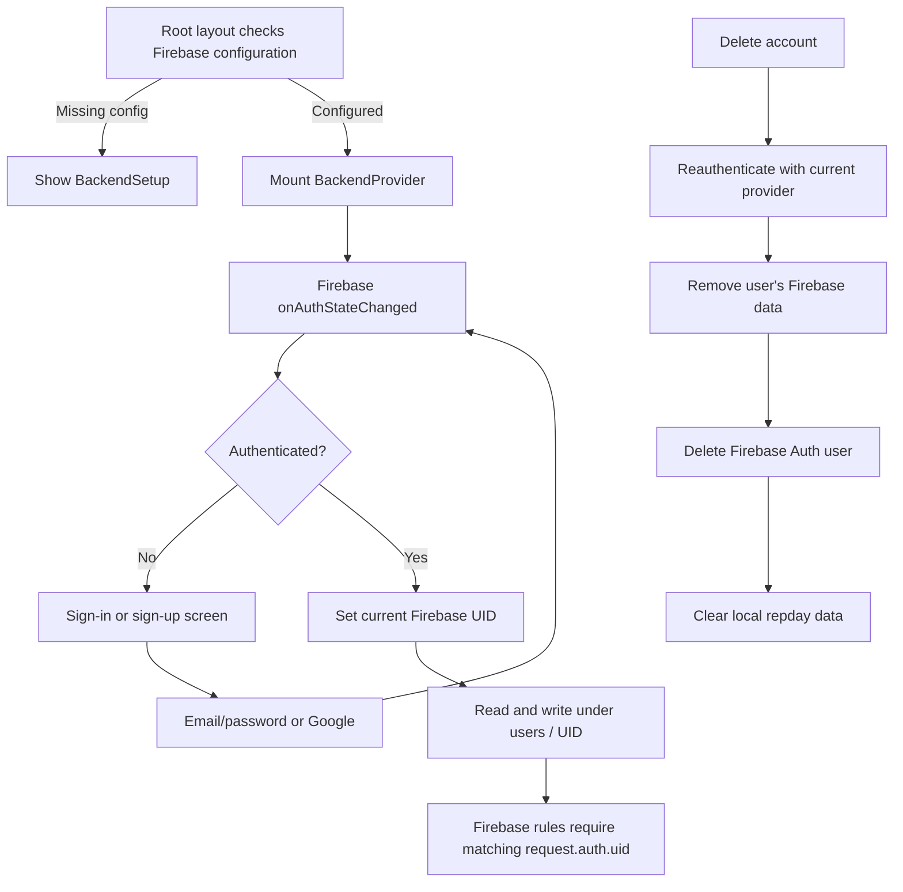

# Authentication and account ownership

Repday uses Firebase Authentication for the signed-in identity. The Firebase UID is the boundary used to select the user's Firestore documents and authorize database and Storage access.

## Sign-in lifecycle

- `app/_layout.tsx` checks whether the Firebase client config is complete. If not, the app displays setup guidance; otherwise it mounts `BackendProvider` around the Expo Router stack.
- `backend/firebase/client.ts` uses Firebase Auth's normal web persistence on web. Native builds initialize Auth with AsyncStorage persistence so a session can survive app restarts.
- `BackendProvider` subscribes to `onAuthStateChanged` and exposes loading, user, sign-in, Google sign-in, Google linking, sign-out, and deletion to the UI.
- Email sign-in and sign-up use Firebase Auth. Google sign-in uses the platform-specific provider helper. Firebase determines whether a Google sign-in created a new user; the UI sends new users through onboarding and returning users to the app.
- Linking Google from Profile attaches the provider to the current Firebase user, preserving that UID and its existing data. Sign-out ends the Firebase session; it does not delete the Firebase account or local AsyncStorage keys.

## Ownership and access

Each account's data lives below `users/{uid}`. `firestore.rules` permits access only when the request is authenticated and `request.auth.uid == userId`. Profile images use `users/{uid}/profile/profile-image`; `storage.rules` applies the same UID check and limits uploads to images under 5 MB.

## Account deletion

Deletion requires recent authentication: password accounts re-enter their password; Google accounts reauthenticate through Google. Only after reauthentication succeeds does the client remove the profile image, nested active-workout set documents, the account's settings/splits/history/active-workout/profile-photo documents, and the user document. It then deletes the Firebase Auth user. Once the operation succeeds, the UI removes local keys beginning with `repday.`.

The cloud cleanup spans multiple Firestore operations and is not one database transaction. If an operation fails partway through, the UI reports the failure and does not clear local data or delete the Auth user; some cloud documents may already have been removed.

## Source files

- `app/_layout.tsx`
- `backend/BackendProvider.tsx`
- `backend/firebase/client.ts`
- `backend/firebase/googleSignIn.ts` and `backend/firebase/googleSignIn.native.ts`
- `backend/firebase/deleteAccount.ts`
- `firestore.rules` and `storage.rules`
