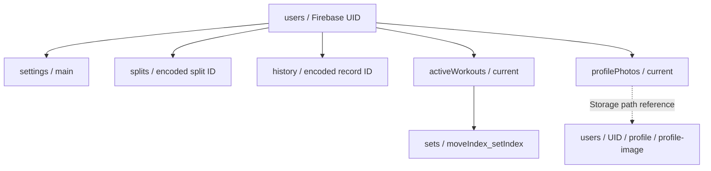

# Firestore and Storage data model

Every user's private data is grouped under `users/{uid}`. The Firestore security rule allows access only to the authenticated UID matching that path. IDs supplied by the app are URL-encoded before being used as split/history document IDs.

| Path | Main fields and purpose |
| --- | --- |
| `users/{uid}/settings/main` | Preferences and app settings: weekly plan, focus draft, selected split, country/time zone, theme, activity layout, training goal, rest duration, weight unit, reminders, `initialized`, and `updatedAt`. Legacy active-workout fields are read as a fallback. |
| `users/{uid}/splits/{encodedSplitId}` | `clientId`, split `data`, ordered `position`, `updatedAt`, and optional `setTargets`. The split data contains exercises and planned sets. |
| `users/{uid}/history/{encodedRecordId}` | `clientId`, completed workout `data`, and `startedAt`, used for newest-first history queries. |
| `users/{uid}/activeWorkouts/current` | Active session key, timer state, working session without embedded set arrays, rest deadline, and `updatedAt`. The implementation can save this, but the active-session UI currently does not call the writer for starts/edits. |
| `users/{uid}/activeWorkouts/current/sets/{moveIndex}_{setIndex}` | One active-session set's move/set indices, weight, reps, completion flag, and whether it was added during the workout. |
| `users/{uid}/profilePhotos/current` | Storage path, download URL, and update timestamp for the profile image. |
| Cloud Storage `users/{uid}/profile/profile-image` | Profile image bytes. Rules require the owner UID, image content type, and a size under 5 MB. |

## Read patterns

`useWorkoutData` listens to `settings/main`, splits ordered by `position`, and the newest 30 history documents ordered by `startedAt`. Older history is loaded with a cursor. Active-workout parent and set collection snapshots are combined into the working session. Profile photo metadata is observed only while the Profile tab is active.

## Write patterns

- Settings are saved with a merge and marked initialized.
- Split creation/upsert stores the full split and position. Full split sync removes missing documents and writes the current list in batches capped below Firestore's 500-write batch limit. Split target changes are stored separately in `setTargets`.
- History upserts store the full record, stable client ID, and timestamp. Full history sync is chunked into batches; the UI reads the first 30 and pages older results.
- Active workout saving stores a parent record and a child document for each set; only non-session-only moves are written. Clearing the session deletes child set documents and the parent.
- Account deletion removes collection documents in batches and deletes nested active set documents before removing the user document.

`firestore.rules` currently gives each authenticated user read/write access to every document below their own `users/{uid}` path. See [Authentication and account ownership](auth-and-account-ownership.md) for the identity boundary.

## Source files

- `backend/firebase/useWorkoutData.ts`
- `backend/firebase/deleteAccount.ts`
- `firestore.rules`
- `storage.rules`
