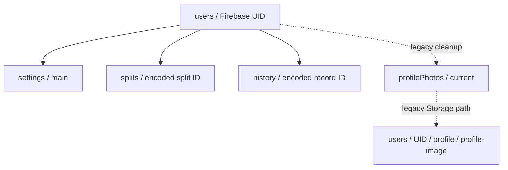

# Firestore and Storage data model

Every user's private data is grouped under `users/{uid}`. The Firestore security rule allows access only to the authenticated UID matching that path. IDs supplied by the app are URL-encoded before being used as split/history document IDs.

| Path | Main fields and purpose |
| --- | --- |
| `users/{uid}/settings/main` | Preferences and app settings: weekly plan, date-specific schedule overrides, focus draft, selected split, country/time zone, theme, activity layout, training goal, rest duration, weight unit, reminders, `initialized`, and `updatedAt`. |
| `users/{uid}/splits/{encodedSplitId}` | `clientId`, split `data`, ordered `position`, `updatedAt`, and optional `setTargets`. The split data contains exercises and planned sets. |
| `users/{uid}/history/{encodedRecordId}` | `clientId`, completed workout `data`, and `startedAt`, used for newest-first history queries. |
| `users/{uid}/profilePhotos/current` | Legacy uploaded-photo metadata retained only for cleanup of older accounts. The current UI uses the Google Auth photo directly. |
| Cloud Storage `users/{uid}/profile/profile-image` | Legacy uploaded image bytes retained only for account-deletion cleanup. |

## Read patterns

`useWorkoutData` owns three stable account-wide listeners: `settings/main`, splits ordered by `position`, and the newest seven history documents ordered by `startedAt`. They remain mounted while the same user is signed in and are not recreated during tab navigation. Older history loads on demand with a cursor. The profile uses the Google Auth photo and does not read profile-photo metadata from Firestore.

The web client initializes Firestore with its IndexedDB-backed persistent cache and multi-tab coordination. This preserves eligible cached documents across reloads and lets tabs share the same local Firestore cache. Server synchronization and Firestore billing rules still apply when a listener must reconnect to the backend.

## Write patterns

- Settings are saved with a merge and marked initialized.
- Split creation/upsert stores the full split and position. Full split sync removes missing documents and writes the current list in batches capped below Firestore's 500-write batch limit. Split target changes are stored separately in `setTargets`.
- History upserts store the full record, stable client ID, and timestamp. Full history sync is chunked into batches; the UI reads the first seven and pages older results.
- Unfinished workouts and set edits stay in AsyncStorage on the current device. Finishing a workout writes one history record; the app has no active-workout Firestore listener or writer.
- Account deletion removes collection documents in batches and also deletes legacy active-workout documents and nested set documents before removing the user document.

`firestore.rules` currently gives each authenticated user read/write access to every document below their own `users/{uid}` path. See [Authentication and account ownership](auth-and-account-ownership.md) for the identity boundary.

## Source files

- `backend/firebase/useWorkoutData.ts`
- `backend/firebase/deleteAccount.ts`
- `firestore.rules`
- `storage.rules`
