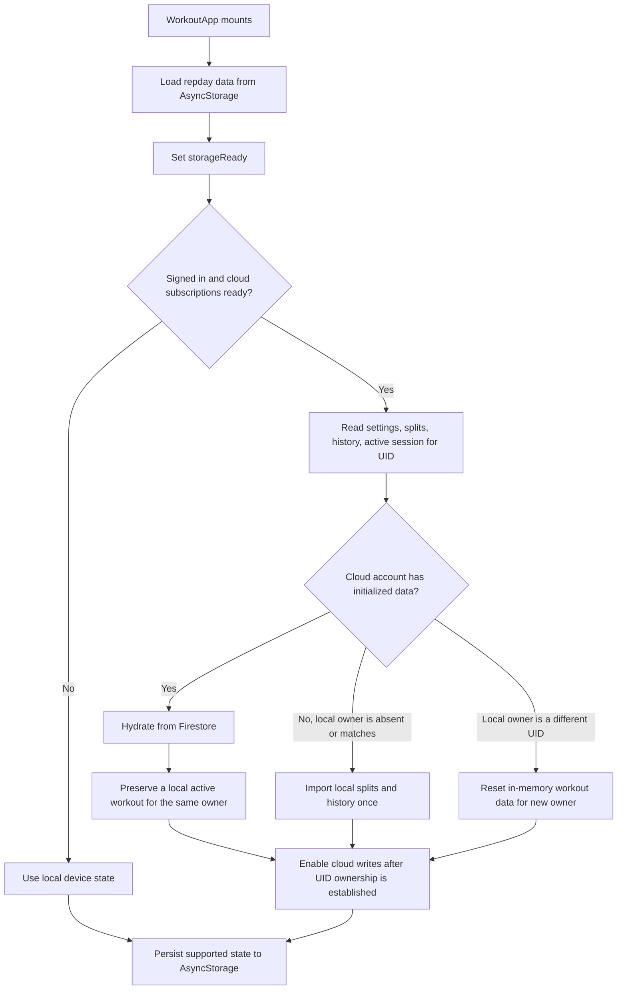

# Local data and Firebase sync

The app uses AsyncStorage for device persistence and Firestore for signed-in account data. Local state is loaded first for responsiveness. Cloud hydration then reconciles it for the current Firebase UID. There is no general-purpose offline outbox that retries every failed write.

## Startup and ownership

1. `WorkoutApp` loads local splits, history, focus draft, active workout, working session, rest deadline, plan, owner ID, and preferences. The `storageReady` flag prevents persistence effects from overwriting data before this read completes.
2. `useWorkoutData` subscribes to Firestore for the authenticated UID. It watches settings, splits, the latest 30 history records, and active-workout parent/set documents. Profile photo metadata is watched while Profile is open.
3. The app waits for required snapshots before hydrating. `cloudOwnerId` prevents mutations from being sent to Firestore until the app has associated its in-memory state with the current account.
4. If Firestore has initialized account data, cloud splits/history/settings replace or merge into local in-memory state. A device-local active workout is preserved when its saved owner is absent or matches the current UID. If the device has no cloud data and its recorded owner is absent or matches, existing local splits/history are imported once. If the recorded local owner is a different UID, the app clears the in-memory workout data and starts with the new account's cloud state/defaults.

## How writes behave

- **Local persistence:** React state changes first; effects write supported state to AsyncStorage (for example `repday.sessions`, `repday.history`, `repday.weeklyPlan`, `repday.focusDraft`, `repday.activeWorkout`, and `repday.working`). Those device keys are not partitioned by UID; the app tracks `repday.localOwner` and resets in-memory account data when switching owners.
- **Cloud writes:** Individual handlers or effects call Firestore after local state updates. Examples include split upserts, history upserts, and settings saves. Several calls are intentionally fire-and-forget and catch errors without surfacing them, so local UI changes can succeed even if cloud sync fails.
- **History migration:** When a signed-in UID has no initialized cloud data and the device owner is absent or matches, the app attempts a one-time import of local splits and history.
- **Active workout:** In-progress data is saved to AsyncStorage and can be restored after restart. The app listens for a cloud active session, but the UI currently does not call the Firestore writer on start or each edit. The writer is used to clear a cloud session on discard. See [Active workout](../frontend/active-session.md).
- **Completed onboarding preferences:** A pending local onboarding draft takes precedence during hydration. After cloud settings save succeeds, its pending-sync marker is cleared; if saving fails, the marker remains.

## Sync caveats

This is a local-first UI with opportunistic Firestore writes, not a fully durable sync queue. Local persistence effects and cloud writes may run concurrently. A network failure can leave local and cloud state different until the relevant flow is revisited or the app's hydration/migration path runs again. Do not assume a visible local change has been confirmed by Firestore unless that handler awaits and handles the write.

## Source files

- `app/index.tsx` — local storage, account hydration, owner checks, and data mutation handlers.
- `backend/firebase/useWorkoutData.ts` — Firestore subscriptions and write methods.
- `backend/firebase/client.ts` — Firebase SDK initialization.
