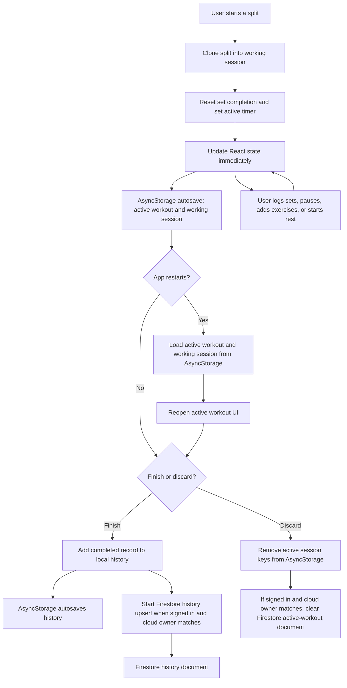

# Active workout session and data flow

This describes how the frontend starts, edits, restores, finishes, and discards an active workout. The current app saves an in-progress session on the device. Its Firestore active-workout reader and writer exist, but the UI does not call the writer when a workout starts or changes; do not assume in-progress edits are backed up to Firebase.

## In-progress session

- Starting a workout clones the chosen split, resets its set completion flags, records the start time, and opens the workout UI.
- Set edits, pause state, rest timer, and active exercises update frontend state. Effects persist `activeWorkout`, `working`, and `restEndsAt` to AsyncStorage on the device.
- On a later app launch, if both the saved active-workout and working-session records exist, the app restores them and reopens the workout screen.
- Firebase active-workout snapshots are read and can be used to restore a cloud session when there is no preserved local session. However, the current app does not call `saveActiveWorkoutCloud` for start or edits. The helper is called on discard to clear a cloud active session. Thus there is currently no continuous or start-time Firebase backup of an active workout.

## Finishing and discarding

- **Finish:** The app builds a workout-history record and adds it to local React state. An AsyncStorage effect persists the history list. For a signed-in user whose cloud data is hydrated, it also starts a Firestore upsert at `users/{uid}/history/{recordId}`. That write is not awaited by the finish handler, so the UI can show the summary before Firebase confirms it. The app also syncs saved split target changes and opted-in exercises.
- **Discard:** The app clears the local active session and removes the corresponding AsyncStorage entries. If the signed-in cloud owner matches, it asks Firebase to remove the active-workout document and its set documents. A failure shows a toast; the local discard still takes effect.

## Storage map

| Data | Local storage | Firebase behavior today |
| --- | --- | --- |
| In-progress timer and working session | AsyncStorage: `repday.activeWorkout`, `repday.working` | Read/listen for remote state; no start/edit save call from the UI |
| Rest timer deadline | AsyncStorage: `repday.restEndsAt` | Included in the active-workout writer, but no regular save call from the UI |
| Completed workout history | AsyncStorage: `repday.history` | Firestore upsert starts on finish when the signed-in cloud owner is ready |
| Discarded active session | Removed from AsyncStorage | Firestore active workout is cleared when the cloud owner is ready |

## Source files

- `app/index.tsx` — workout state, local persistence effects, start/edit/finish/discard handlers, and cloud hydration.
- `backend/firebase/useWorkoutData.ts` — Firestore active-workout snapshot reader and save/delete implementation, plus completed-history upsert.
