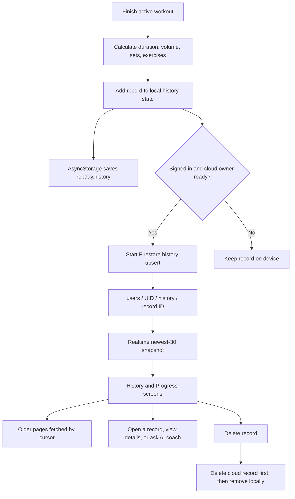

# Workout history and progress

Finishing a session creates a completed workout record. The frontend updates its in-memory history immediately, persists history to AsyncStorage through an effect, and starts a Firestore upsert when the signed-in account is ready.

## Record creation and sync

On finish, the app removes active-session-only metadata from the saved session and creates a record with an ID based on completion time, split name, start time, duration, volume, completed set count, exercise count, and the completed session details. Volume is calculated from completed sets using weight × reps. The record is added to local state immediately; an AsyncStorage effect persists the history list. If the signed-in UID is hydrated, `upsertHistoryItemCloud` starts a Firestore write at `users/{uid}/history/{encodedRecordId}`. The finish handler does not await that write, so the summary is shown without waiting for cloud confirmation.

On hydration, the remote listener supplies the newest 30 records ordered by `startedAt`. The app merges these with local history by record ID and sorts newest first. “Load older workouts” fetches more pages using a Firestore cursor. When a new account has no cloud data, the local-history migration path may import existing device records.

## Progress views

History can be filtered to the last 7, 14, or 30 days or a chosen date. A detail view shows the saved session record. The Progress view calculates volume and completed sets from the available history, with all-time, current-week, and current-month ranges; the activity calendar marks dates with completed records and reflects planned rest days. AI Coach can receive a selected completed record as context.

## Deletion and failure behavior

Deleting a history record first awaits the Firestore deletion when the current user owns the cloud data. Only after that succeeds does the app remove the record from local state. If the Firestore delete fails, the record remains visible and the UI shows an error. This is stricter than completion, where the history upsert is fire-and-forget.

## Source files

- `app/index.tsx` — finish handler, local history, filters, progress aggregates, and deletion UI.
- `backend/firebase/useWorkoutData.ts` — history listeners, pagination, upsert, and delete.
