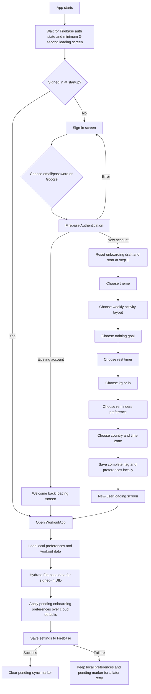

# Frontend onboarding flow

This documents the current first-run path through the Expo app: authentication, new-account onboarding, preference storage, and entry into the workout app.

## What happens in each part

1. **Startup and authentication.** `app/index.tsx` waits for Firebase Auth to resolve and for a minimum three-second loading screen. Signed-out users see `SignInScreen`. It supports email/password sign-in and sign-up, plus Google sign-in.
2. **New versus returning accounts.** Firebase's result identifies new accounts. New accounts reset the onboarding draft and enter onboarding. Existing accounts go through a welcome-back loading screen directly into the app. Authentication errors remain on the sign-in screen with an inline message.
3. **Seven preference steps.** The sequence is theme, weekly activity layout, training goal, rest duration, weight unit, reminders preference, and country/time zone. Each choice updates the draft. The screen saves the draft and current step to device storage. Current startup routing does not resume unfinished onboarding after a cold launch when Firebase still considers the user signed in; it opens `WorkoutApp` directly.
4. **Completion and sync.** Finish writes `repday.onboardingComplete`, `repday.onboardingPrefs`, and a pending-sync marker to AsyncStorage. After the loading screen, `WorkoutApp` applies the pending preferences locally. Once the signed-in Firebase user and app data are hydrated, it saves settings to that user's Firebase settings document. A successful save clears the marker; a failed save leaves it in place so local values are kept and can be retried on a later launch.

The initial preferences are light theme, compact weekly activity, strength goal, 90-second rest, kilograms, reminders off, India, and `Asia/Kolkata`.

## Source files

- `app/index.tsx` — app entry routing and post-auth loading states.
- `components/SignInScreen.tsx` — authentication UI, onboarding steps, local draft persistence, and completion.
- `backend/BackendProvider.tsx` — Firebase Auth state, email/password, and Google sign-in.
- `backend/firebase/useWorkoutData.ts` — Firebase settings reads and writes.
