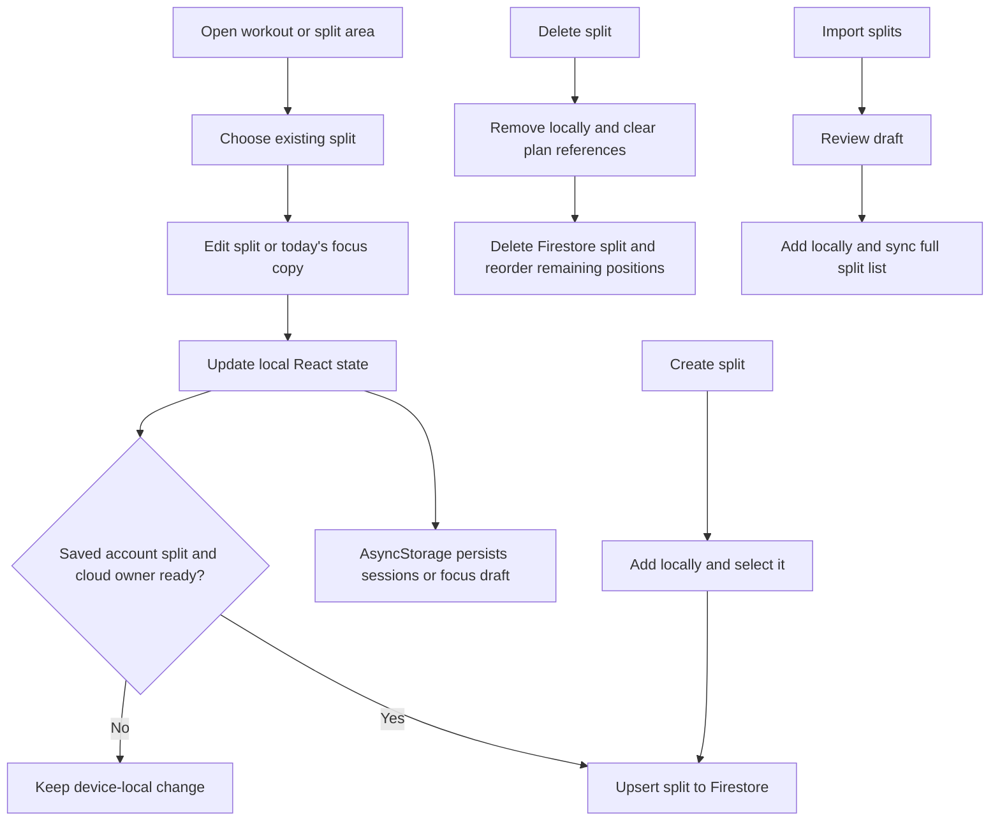

# Workout split management

Splits are the reusable workout templates: named sessions containing exercises, set targets, and display metadata. The frontend keeps the current list in React state and AsyncStorage, then sends cloud writes when the signed-in UID has been hydrated.

## Create, edit, and delete

- Creating a split requires a non-empty trimmed name. The app creates a client ID, uses a default description when needed, adds the split to local state, selects it, and attempts a Firestore upsert when the user's cloud owner is ready.
- Editing a saved split patches local `sessions` and attempts an upsert. The workout for today's focus can instead be edited as a `focusDraft`, which is saved with app settings rather than overwriting the reusable split.
- Removing a split updates local state and clears weekly-plan references. When signed in, the app deletes the corresponding Firestore document and then updates remaining positions. A cloud error is caught; the local change still takes effect.
- The built-in sample IDs (`push`, `pull`, and `legs`) are filtered out of user cloud sync to avoid treating sample templates as account-owned custom splits.

## Plan and workout progression

Weekly plan, selected split, and focus draft are stored in settings. Settings are saved after local state updates when storage is ready, the user is authenticated, and `cloudOwnerId` matches the Firebase UID. At workout completion, changed weights/reps for exercises from the saved split update its `setTargets`; new exercises explicitly marked to add to the split are appended with incomplete sets.

During an active workout, edits apply to the working session. They are not immediately written to the reusable split; progression is applied at finish. See [Active workout](active-session.md).

## Import and exercise metadata

Split imports create reviewable drafts before adding them to the user's list. See [Workout import](workout-import.md). Exercises can be selected from the local exercise catalog; when an exercise matches, its image, animation, target muscle, equipment, and instructions are reused. Some media is cached separately from Firestore session data.

## Source files

- `app/index.tsx` — split state, editing, planning, and mutation handlers.
- `backend/firebase/useWorkoutData.ts` — split document sync and target writes.
- `lib/workoutNoteParser.ts` — local note parsing.
