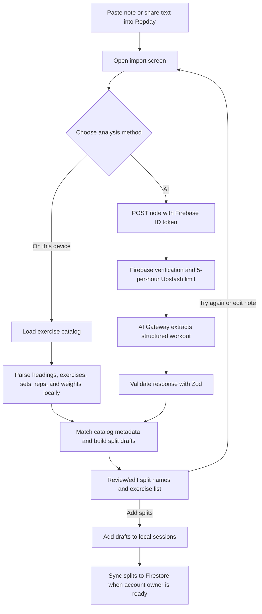

# Workout-note import

Workout import accepts pasted notes or shared text. Users can parse locally on the device or send the note to the server for AI extraction. Both paths produce editable split drafts; nothing is added to the saved split list until the user reviews and confirms.

## Input sources

- The import screen accepts text pasted into its note field.
- The native share integration can deliver shared text. `useIncomingShare` joins incoming text payloads, opens the import screen, and clears the handled share payload.
- The UI describes local analysis as device-only. AI analysis sends the note to the Repday API and through Vercel AI Gateway.

## Local analysis

`lib/workoutNoteParser.ts` groups lines under split/day headings and recognizes exercise prescriptions such as `Bench Press — 3 x 8 at 40 kg`. It uses the exercise catalog to normalize known names. The parser clamps set/repetition counts, converts pounds to kilograms, and defaults missing weight to zero. If no exercise prescriptions are found, the UI displays a formatting hint and keeps the user in the import screen.

## AI analysis

The client calls `POST /api/analyze-workout` with the note and Firebase ID token. The server rejects unconfigured requests, invalid/empty input, and notes over 15,000 characters. It verifies the Firebase token and applies the Upstash limit of 5 requests per user per rolling hour before calling AI Gateway. The model returns structured JSON, which the route parses and validates with Zod; malformed or incomplete output becomes an error rather than being saved. AI failures are shown in the import screen, where users can retry or use local analysis.

The client maps returned exercises to known catalog metadata when possible. Unknown exercise names can remain in the draft as custom entries. Both local and AI drafts stay editable: the user can change split names, inspect exercises and set prescriptions, and add the generated splits only after review.

## Saving

Confirming Add immediately appends the drafts to local `sessions`, selects the first imported split, caches media, clears the draft/note, and closes the import screen. If the signed-in UID is hydrated, the app then attempts a full split sync to Firestore. A cloud sync error is caught; the local splits remain on the device.

## Source files

- `app/index.tsx` — incoming-share handling, analysis actions, draft review, and save.
- `lib/incomingShare.ts` — shared content integration.
- `lib/workoutNoteParser.ts` — device-local parsing.
- `backend/ai.ts` — authenticated API client.
- `app/api/analyze-workout+api.ts` — Gateway request, input validation, and structured-output validation.
- `app/api/_lib/aiRateLimit.ts` — Firebase identity and Upstash limits.
