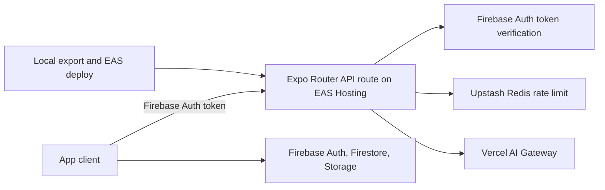

# Production and configuration

Repday is an Expo app whose web build includes Expo Router API routes. EAS Hosting serves the production web app and API routes. Firebase handles identity, user data, and profile-photo storage; Vercel AI Gateway handles model requests; Upstash Redis holds AI rate-limit counters.

## Production deployment

- `app.json` sets `web.output` to `server`, so the web export contains both static client assets and server API routes.
- `npm run deploy:web:prod` runs the web export using the EAS `production` environment, then runs `eas deploy --environment production --prod` to publish/promote the hosting deployment.
- `npm run deploy:web:preview` uses the EAS `preview` environment and deploys a preview.
- EAS Hosting deployments are immutable. After changing server environment variables, export and deploy again for the new values to be used.
- `npm run update:prod` publishes an EAS Update to the native/runtime channel; it is not the command that republishes the EAS Hosting API routes.

## Service responsibilities

| Service | Responsibility |
| --- | --- |
| Expo/EAS Hosting | Serves web assets and runs `/api/coach` and `/api/analyze-workout`. |
| Firebase Authentication | Email/password and Google identity; issues ID tokens. |
| Firestore | UID-scoped settings, splits, history, and active-session documents. See [Firestore model](../backend/firestore-data-model.md). |
| Firebase Storage | UID-scoped profile photo bytes. |
| Upstash Redis | Per-user, per-feature request counters checked before AI Gateway. See [rate-limit internals](<../system design/ai-rate-limiting.md>). |
| Vercel AI Gateway | Routes approved requests to the configured model. Provider credentials remain server-side. |

## Environment variables

`.env.example` lists the required names. `EXPO_PUBLIC_*` values are bundled into the client and must contain only public Firebase app identifiers/configuration and the API origin. The following are server-only and must not use an `EXPO_PUBLIC_` prefix:

- `AI_GATEWAY_API_KEY` — authenticates API routes to AI Gateway where configured.
- `AI_GATEWAY_MODEL` — server-side model selection for workout import.
- `UPSTASH_REDIS_REST_URL` and `UPSTASH_REDIS_REST_TOKEN` — Upstash rate-limit store credentials.

The API route also reads Firebase's public web API key to verify an ID token with Firebase Auth. That is a public Firebase config value; user data access is enforced by Auth and Firebase Rules, not by hiding that key.

## Security rules and deploy boundaries

`firestore.rules` allows a signed-in user to read/write only under `users/{theirUid}`. `storage.rules` applies the same owner check and constrains profile image size/type. `firebase.json` points Firebase CLI to these rules and configures Email/Password and Google sign-in. Updating Firebase rules/provider settings is a Firebase deployment/configuration action separate from deploying the EAS web/API app.

Production secrets are configured in EAS project environment variables with secret visibility. Never commit `.env.local` or secret values. Rate-limit thresholds and failure behavior are documented in [AI request rate limiting](<../system design/ai-rate-limiting.md>).

## Source files

- `app.json`, `eas.json`, `package.json`
- `.env.example`
- `firebase.json`, `firestore.rules`, `storage.rules`
- `app/api/coach+api.ts`, `app/api/analyze-workout+api.ts`
- `backend/ai.ts`, `app/api/_lib/aiRateLimit.ts`
