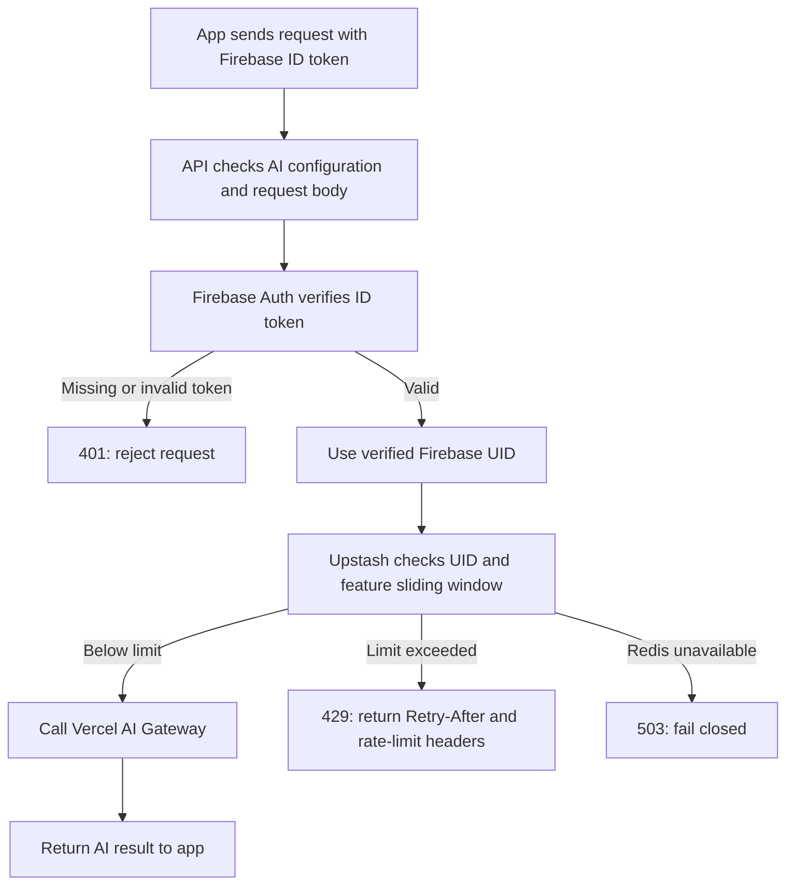

# AI request rate limiting

The AI Coach and workout-note import API routes authenticate each request with Firebase, then use Upstash Redis to enforce per-user rolling-window limits before calling Vercel AI Gateway.

## Limits

| Endpoint | Limit per Firebase user | Window |
| --- | ---: | --- |
| AI Coach | 10 requests | Rolling 1 minute |
| Workout-note import | 5 requests | Rolling 1 hour |

Upstash applies each check atomically using its sliding-window limiter. The counter key includes both the verified user ID and the feature, so coach requests and workout imports have separate limits. Requests rejected by the limiter do not reach AI Gateway.

The API returns `401` when the Firebase token is missing or invalid, `429` when the user's limit is reached, and `503` if Firebase verification or Upstash is unavailable. Redis failures fail closed to avoid sending unmetered AI requests.

## Configuration

Set `UPSTASH_REDIS_REST_URL` and `UPSTASH_REDIS_REST_TOKEN` as server-side secrets in local development and the production API environment. The token must never be exposed to the client bundle or committed to the repository.
