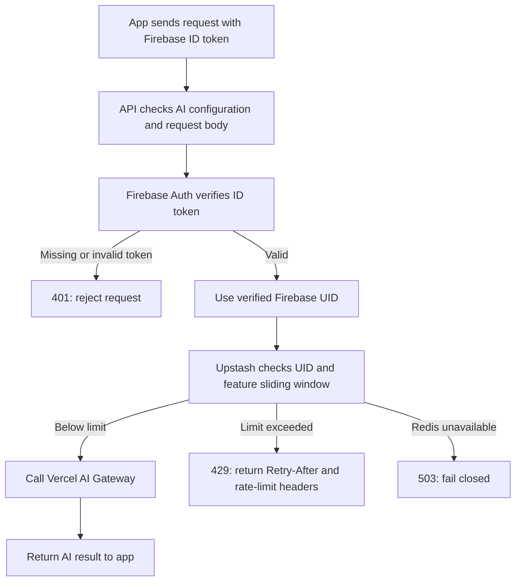

# AI request rate limiting

The AI Coach and workout-note import API routes authenticate each request with Firebase, then use Upstash Redis to enforce per-user rolling-window limits before calling Vercel AI Gateway.



## Limits

| Endpoint | Limit per Firebase user | Window |
| --- | ---: | --- |
| AI Coach | 10 requests | Rolling 1 minute |
| Workout-note import | 5 requests | Rolling 1 hour |

## What Redis stores and compares

This implementation does **not** save a separate timestamped record for every request. `@upstash/ratelimit` uses two time-bucket counters per user and feature:

- Coach keys follow `repday:ai:coach:<firebase-uid>:<window-number>`.
- Workout-import keys follow `repday:ai:workout-import:<firebase-uid>:<window-number>`.
- Each value is an integer request count for that fixed bucket. The current bucket expires after roughly two windows, long enough to remain available as the previous bucket when the next window starts.

For every call, the limiter uses the current time to identify the current and previous buckets. It estimates how many requests fall inside the rolling window with:

```text
estimated requests = current bucket count
                   + floor(previous bucket count × fraction of the window still remaining)
```

For example, 45 seconds into a 60-second coach window, 25% of the current window remains. If the previous bucket has 8 requests and the current bucket has 7, the estimate is `7 + floor(8 × 0.25) = 9`; the next request is allowed and the current bucket increments. If the current bucket already has 8, the estimate is `8 + 2 = 10`; the request is rejected with `429`.

The read, comparison, and increment run together in a Redis Lua script, so simultaneous requests cannot independently pass using the same stale count. This is Upstash's weighted sliding-window approximation: Redis stores bucket counts, while the API computes the previous-bucket weight from the current timestamp. It does not need a list of per-request timestamps.

The feature-specific key prefixes keep coach and workout-import usage separate. A rejected request does not increment the counter or reach AI Gateway. A Redis failure returns `503` (fail closed).

The API returns `401` when the Firebase token is missing or invalid, `429` when the user's limit is reached, and `503` if Firebase verification or Upstash is unavailable. Both Firebase infrastructure errors and Redis errors fail closed so an infrastructure outage does not allow unmetered AI requests.

## Configuration

Set `UPSTASH_REDIS_REST_URL` and `UPSTASH_REDIS_REST_TOKEN` as server-side secrets in local development and the production API environment. The token must never be exposed to the client bundle or committed to the repository.
