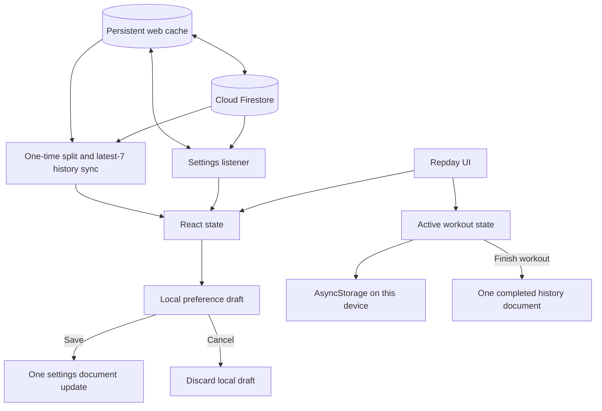

# Firestore optimizations and caching

> **19 October 2026 update:** Split startup and live synchronization now use an account revision and a complete per-account local snapshot. See [Persistent split caching with account revisions](split-revision-cache.md) for the current implementation, migration, concurrency behavior, and operation counts. The earlier split-fetch/listener description below records the previous design. Startup history now loads the complete current Monday–Sunday week rather than a fixed seven records.

**Status:** Implemented  
**Last updated:** 17 October 2026  
**Applies to:** Repday web, iOS, and Android clients using Cloud Firestore Standard

This document explains the database optimizations currently implemented in Repday, why they were added, how caching works, and what Firestore usage to expect from common user actions. It is intended to be useful both as an architecture reference and as a practical guide for a developer investigating another read or write spike.

## Goals

The changes address four problems:

1. Avoid writing every intermediate UI choice to Firestore.
2. Avoid reading large collections when the screen only needs a small window of data.
3. Avoid realtime listeners for data that does not need live cross-device updates.
4. Preserve a responsive app when the network is slow or temporarily unavailable.

The resulting design keeps the small settings document synchronized in realtime, while splits, history, and transient workout state use local-first data on the device. Repday Plus members may opt into live split/history synchronization.

## Firestore billing model used by this design

Firestore bills document operations rather than individual fields.

- Reading one document counts as one document read, whether the app uses one field or every field.
- Writing one document counts as one document write, whether one field or many fields change.
- A batch groups requests atomically, but each document written in that batch is still a billed document write.
- A query is billed for the documents it reads or returns according to Firestore's query-pricing rules. A query returning seven workout documents should normally be considered roughly seven document reads, not one query read.
- A realtime listener performs an initial query. Later document changes delivered to that listener can create additional reads.
- A local React state update or an AsyncStorage update is not a Firestore read or write.

These rules are why consolidating several preference changes into one settings-document update saves writes, while paginating workout history saves reads.

## Current data flow



## 1. Stable account-level Firestore access

`backend/firebase/useWorkoutData.ts` owns the account data subscriptions. The hook is called once by the main `WorkoutApp` component, and its results are passed to the screens that need them. Child screens do not create their own copies of these listeners.

There is one always-on realtime listener, plus an optional Plus-only pair:

| Access pattern | Firestore path/query | Purpose |
| --- | --- | --- |
| Settings | `users/{uid}/settings/main` | Theme, weekly plan, preferences, date-specific schedule overrides, and other account settings |
| Startup split sync | `users/{uid}/splits`, ordered by `position` | Fetches saved splits once when an authenticated app session starts |
| Startup history sync | `users/{uid}/history`, ordered by `startedAt desc`, limited to 7 | Fetches the default recent history once when an authenticated app session starts |
| Plus live split sync | `users/{uid}/splits`, ordered by `position` | Optional instant updates across devices |
| Plus live history sync | `users/{uid}/history`, ordered by `startedAt desc`, limited to 7 | Optional instant recent-history updates across devices |

Normal navigation does not rerun these operations. The settings listener is cleaned up when the user changes, signs out, retries the connection, or the owning component unmounts. Plus live listeners start only when the saved **Live cross-device sync** preference is on, and unsubscribe immediately when it is turned off or Plus access ends.

### Why this matters

If every screen called a hook that created its own `onSnapshot`, the same document change could be delivered to multiple active subscriptions and billed multiple times. Repday keeps the one settings listener at the account level and uses bounded one-time queries for the larger collections.

Each device or browser session still has its own connection. One laptop and one phone signed into the same account are separate clients and may each receive a billed settings read when that document changes.

## 2. Preference changes are drafted locally

On the Profile screen, editable settings are copied into a local `SettingsDraft`. Controls update this draft immediately so the interface can preview the selected values without writing to Firestore.

When a draft differs from the saved values, an **Unsaved preferences** overlay appears:

- **Cancel** discards the draft and restores the last saved settings.
- **Save** sends the entire supported preference set to `users/{uid}/settings/main` with one merged `setDoc` operation.

Changing theme, activity layout, weekly plan, training goal, rest duration, units, reminders, country, and time zone before pressing Save therefore produces one settings-document write instead of one write per control change.

The settings listener will normally deliver the committed version back to the client. That delivery may count as a read. The application also keeps a stable serialized signature of the last server value and tracks writes in flight so identical saves and duplicate concurrent saves are skipped.

### Expected operations

| Action | Firestore writes | Possible listener reads on one connected client |
| --- | ---: | ---: |
| Change five preferences, then Cancel | 0 | 0 from those local edits |
| Change five preferences, then Save | 1 settings-document write | Usually 1 settings-document listener delivery |
| Press Save without changing the stored values | 0 | 0 |

Onboarding can still collect and preview several choices locally. It does not need a Firestore write after every onboarding page.

## 3. Splits and workout history are cache-first

On signed-in startup, Repday first asks Firestore for its persisted local result, then performs one explicit server query for splits and for the latest seven history records:

```ts
getDocsFromCache(splitsQuery)
getDocsFromCache(latestHistoryQuery)
getDocsFromServer(splitsQuery)
getDocsFromServer(latestHistoryQuery)
```

The cache calls do not contact Firestore. The server calls are deliberate startup synchronization, not snapshot listeners. For cache-only users, locking an iPhone, reconnecting after more than 30 minutes, or resuming a suspended browser does not recreate split/history queries because none are subscribed. A Plus member who enables live sync intentionally accepts the normal realtime-listener reconnect behavior.

After a local split edit or completed workout, the current device updates React state and AsyncStorage immediately, then writes the changed cloud document. It does not read that document back. A second device sees cached data until it performs its own launch sync or an explicit history query.

### Pagination

`loadMoreHistory(count)` starts after the current cursor and requests only the additional number of documents required. Results are merged into local state without duplicating records already in the cache.

- Default range: latest 7 documents.
- Larger ranges: fetch additional pages on demand.
- “Load older workouts”: fetches the requested next page rather than rereading the first page.

### Date-specific lookup

Selecting a date calls `loadHistoryDate(timestamp)`, which queries the start and end of that single day. It does not load the entire history collection just to locate one date.

### Expected operations

If one workout is stored per history document:

| Action | Approximate document reads |
| --- | ---: |
| Start or reload the app with at least 7 history records | Up to 7 for the one-time first-page sync |
| Expand from 7 to 14 records | Up to 7 additional reads |
| Expand from 14 to 30 records | Up to 16 additional reads |
| Select one date containing one workout | Usually 1 returned document read |

Actual billing can vary with cache state, reconnect behavior, empty-query minimums, index-entry billing, and multiple client instances. Use Firestore Query Insights and Usage dashboards for production measurements.

## 4. Unfinished workouts stay local

The application no longer creates Firestore listeners for:

- `users/{uid}/activeWorkouts/current`
- `users/{uid}/activeWorkouts/current/sets`

It also no longer writes every set edit, timer change, added set, or removed set to those cloud paths.

The active workout, editable working session, timer data, and related transient state are stored in AsyncStorage on the current device. React state drives the live workout interface. When the workout is finished, Repday writes the completed workout to a single document in `users/{uid}/history`.

This removes idle active-workout reads and prevents a gym session from generating a stream of Firestore writes for every interaction.

### Trade-offs

- An unfinished workout can be restored on the same device while its local AsyncStorage data remains available.
- It does not synchronize live to another device.
- Clearing site/app data removes that recovery state.
- Completing a workout still writes its history record to Firestore.
- Old `activeWorkouts` documents may remain from previous versions, but the current app does not subscribe to or update them. Account deletion still cleans them.

## 5. Automatic rest-day history scanning was removed

The old automatic rest-day process could repeatedly walk older workout history in pages of 30 records. That made an idle or repeatedly mounted client capable of producing unnecessary history reads.

The current app determines normal rest state from:

- the recurring weekly plan;
- explicit `restDays` values; and
- date-specific `scheduleOverrides`.

There is no background loop that continuously scans older history to decide whether today is a rest day.

## 6. Temporary today/tomorrow swaps use one settings write

A confirmed workout-day swap creates date-specific entries in `scheduleOverrides`. It swaps today's and tomorrow's effective assignments, including a workout/rest combination, without modifying the recurring weekly plan.

The complete override map is merged into `users/{uid}/settings/main` with one document write. The existing settings listener then supplies the updated settings to the interface, allowing the weekly bar and calendar to update from the same shared state.

Redundant overrides are removed when an assignment matches the recurring base plan. Past override entries are pruned when the next swap map is built.

### Expected operations for one connected device

- Confirm swap: 1 settings-document write.
- Settings listener receives the change: usually 1 settings-document read/delivery.
- Re-rendering the bar and calendar from React state: 0 extra Firestore operations.

Viewing the workout-history screen is separate. The cached first page supplies its default data; a swap itself does not write workout history. A history document is created only when the user finishes a workout.

## 7. Profile photos use Google Auth data

The Profile screen displays the photo URL already supplied by Firebase Authentication for the linked Google account. It does not query a Firestore profile-photo document and does not offer custom photo upload or removal controls.

Legacy uploaded-photo metadata and Storage objects may remain for older accounts. Account deletion continues to clean them, but the current app does not read or modify them during normal use.

## 8. Persistent Firestore cache on web

The web client initializes Firestore with:

```ts
initializeFirestore(app, {
  localCache: persistentLocalCache({
    tabManager: persistentMultipleTabManager(),
  }),
});
```

This enables Firestore's persistent browser cache, backed by browser storage, and coordinates access across multiple tabs. Cached documents and pending local mutations can survive a normal page reload and browser restart, subject to the browser's storage policies.

### What the cache improves

- Previously loaded data can render from local storage while the network reconnects.
- Temporary network outages do not immediately make the app unusable.
- Multiple tabs can safely share the persistent Firestore cache.
- Pending Firestore writes can be queued and sent when connectivity returns.

### What the cache does not guarantee

- It does not make server reads free.
- An active realtime listener still checks the backend and receives changes.
- A listener reconnect after a meaningful disconnect may be billed like a new query. With offline persistence enabled, Firestore's pricing rules treat a listener disconnected for more than 30 minutes as a new query when it reconnects.
- Signing in on another device creates another client connection and its own operation pattern.
- Private browsing, storage eviction, user-cleared site data, or restricted browser storage can remove the cache.

The initialization catches the “already initialized” case used during development Fast Refresh and reuses the existing Firestore instance. That catch is a compatibility fallback; it should not be interpreted as confirmation that persistence was newly enabled on an instance that had already been initialized with different options.

## 9. Native caching and AsyncStorage

Native platforms currently create Firestore with `getFirestore(app)`. The explicit `persistentLocalCache` configuration in this code is web-only.

AsyncStorage serves a separate purpose:

- Firebase Auth uses AsyncStorage persistence on native so the user remains signed in.
- Repday persists the current device's split and workout-history view in AsyncStorage so a completed workout or split edit is visible immediately without a Firestore readback.
- Repday stores its active workout recovery state locally in AsyncStorage.
- The selected AI Coach model is also stored locally.

AsyncStorage is not a Firestore cache. Reading and writing it does not consume Firestore document quota.

## 10. Training-plan builder access

The plan builder remains available during initial onboarding so a new user can create a usable starting plan. After onboarding, opening the builder from Profile requires Repday Plus. The Cyberpunk theme is also a Plus feature: onboarding offers Light and Dark, while Profile shows Cyberpunk with the Plus treatment and opens the subscription dialog for free accounts.

This is primarily a product entitlement decision. The database savings come from drafting builder choices locally and persisting the final plan, rather than writing every builder screen selection. Paywall checks use the already loaded billing-access state rather than adding a Firestore billing lookup for every button press.

## Operation examples

The following estimates assume one signed-in browser, a warm app instance, and no retries. They are intended for reasoning about relative cost, not as an invoice prediction.

| User flow | Writes | Reads/deliveries caused by the flow |
| --- | ---: | ---: |
| Toggle theme five times, then Cancel | 0 | 0 |
| Change five preferences, then Save | 1 | Usually 1 settings delivery |
| Confirm today/tomorrow swap | 1 | Usually 1 settings delivery |
| Edit ten sets during an unfinished workout | 0 | 0 Firestore operations |
| Finish that workout | 1 history write + 1 lifetime-aggregate update in one transaction | 0 readback on the current device |
| Open or return to Profile | 0 | 0 profile-photo document reads |
| Start/reload the app with default history | 0 | Up to 7 one-time history reads |
| Load seven older workouts | 0 | Up to 7 additional history reads |

The Progress All time summary uses lifetime counters stored on the account settings document rather than loading every historical workout. Existing accounts are backfilled once; later completions increment the counters atomically with the history write, so a warm or fresh launch only uses the settings read already needed for startup.

If the same account is open on two connected devices, a settings change may be delivered to both clients. Split and history changes do not automatically reach the second device; it receives them at its next startup sync or when it explicitly queries history.

## Monitoring and diagnosis

When usage rises unexpectedly:

1. Open Firestore **Usage** to identify the time window and operation type.
2. Use **Query Insights** grouped by query or collection group to identify the collection producing operations.
3. Compare `Executions`, `Read operations`, `Average documents scanned`, and `Average results returned`.
4. Inspect code for `onSnapshot`, `getDoc`, `getDocs`, `setDoc`, `updateDoc`, `deleteDoc`, and `writeBatch` against that collection.
5. Check whether the same listener is mounted in more than one component or app instance.
6. Check reconnect loops, retries, Fast Refresh, multiple browser tabs, automated tests, and old deployed clients.
7. Reproduce with one device and one tab, then compare the query metrics again.

The current always-on `onSnapshot` call is limited to the settings document. The two split/history listeners are controlled by the Plus live-sync preference. Any new realtime listener should be justified by a user-visible need for immediate cross-device updates.

## Verification checklist

### Preferences

- Change several Profile preferences and confirm no Firestore write occurs before Save.
- Press Cancel and confirm the saved values return.
- Press Save and confirm one settings-document update contains the final values.
- Press Save again without changing anything and confirm no duplicate update is sent.

### History

- Confirm the initial history query has `LIMIT 7` in Query Insights.
- Select 14 and 30 days and confirm only the additional required page is requested.
- Select a date and confirm the query is bounded by that day's timestamps.

### Active workout

- Start a workout and edit several sets; confirm no `activeWorkouts` or active-set Firestore traffic appears.
- Reload on the same device and confirm AsyncStorage restores the unfinished session.
- Finish the workout and confirm one completed history document is written.
- Discard a workout and confirm no history document is created.

### Persistent web cache

- Load the app once online, then reload with a temporarily unavailable network and confirm cached account data can appear.
- Inspect browser storage to confirm Firestore persistence data exists.
- Open two tabs and confirm they operate without persistence ownership errors.
- Restore the network and confirm the next startup sync obtains fresh split/history data.

## Relevant files

| File | Responsibility |
| --- | --- |
| `backend/firebase/client.ts` | Firebase initialization and persistent multi-tab web cache |
| `backend/firebase/useWorkoutData.ts` | Settings listener, cache-first split/history sync, paginated history, and deduplicated settings writes |
| `app/index.tsx` | Local preference draft, Save/Cancel UI, local active workout state, history ranges, Plus gate, and swap flow |
| `lib/restDays.ts` | Date keys, effective schedule calculation, and temporary schedule swaps |
| `backend/firebase/trainingPlans.ts` | Final generated-plan installation |
| `backend/contracts.ts` | Shared backend binding and settings types |
| `../incidents/firestore-quota-incident-2026-10-16.md` | Original quota incident, evidence, diagnosis, and immediate remediation |
| `settings-preference-write-amplification.md` | Detailed analysis of the preference write-amplification issue |

## Rules for future changes

Before adding Firestore access, answer these questions:

1. Does this data need realtime cross-device updates? If not, prefer a bounded one-time read.
2. Can the user finish editing locally and save once? If yes, avoid writing on every control change.
3. Can the query be limited to what is visible? If yes, add a limit, cursor, or date boundary.
4. Is the listener owned once at the account/app level? Avoid starting the same subscription in multiple screens.
5. Is transient data useful on another device? If not, keep it in React state or AsyncStorage.
6. What is the worst-case document count for the query?
7. What happens when the client disconnects, reconnects, opens another tab, or runs on another device?
8. Can Query Insights clearly identify this query after deployment?

Following these rules keeps Firestore usage proportional to deliberate user actions and visible data instead of component renders, navigation events, or background retry behavior.
