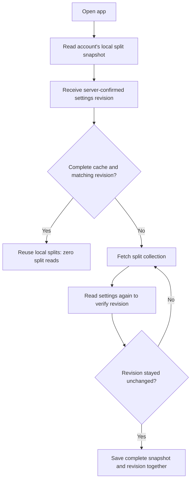

# Persistent split caching with account revisions

Implemented: 19 October 2026. Applies to the shared Firebase adapter used by web, iOS, and Android. The browser stores AsyncStorage values in local storage; Firestore also maintains a separate IndexedDB cache on web.

## Why we changed the previous implementation

Workout splits are usually stable across many app launches. Downloading all six saved splits every morning is unnecessary when yesterday's complete copy is already on the device. Local reads and writes do not consume Firestore document operations.

Previously, `useWorkoutData` first read the split query from Firestore's cache, then unconditionally called `getDocsFromServer` for the entire split collection. Plus live sync also attached an `onSnapshot` listener to that collection. Local storage made the app render faster, but did not prevent the explicit network query. The overlapping Plus paths could add work; actual billing for overlapping SDK requests must be measured rather than assumed to double.

Simply removing the network query would leave devices unable to discover edits made elsewhere. A local copy says what the device last saw; it cannot say whether Firebase has changed since then. A new browser must also distinguish a genuinely empty library from a missing cache.

We considered a shared `needsRefresh` boolean. It fails across devices: device A sets it true after editing; device B downloads the changes and resets it false; device C can then retain an older cache because B cleared the shared flag. A counter records the generation of the data without any browser clearing another browser's signal.

## Data model

The existing `users/{uid}/settings/main` document gains:

```ts
splitsRevision: 12
splitsMutationId: 'identifier-of-last-split-operation'
```

`splitsRevision` is a nonnegative integer. Each logical split operation advances it once, atomically with the split writes. It is not incremented per exercise, per set, per rendered screen, or per app launch. The mutation ID lets the browser recognize its own acknowledged operation; it is not an authorization token.

The complete local snapshot is a single AsyncStorage value at `repday.splitCache.{uid}`:

```ts
{
  version: 1,
  userId: 'account-uid',
  revision: 12,
  documents: [/* complete raw split documents, including targets and positions */]
}
```

The owner, schema version, revision, document identity, and basic data shape are checked before accepting this cache. A missing or invalid value is `null`, not an assumed revision of zero. An empty `documents: []` with valid metadata is a complete snapshot and can be reused.

The older `repday.sessions` cache remains the UI's local recovery copy. It is not trusted as a revision-certified snapshot because it has no associated revision and may include local edits or catalog-enriched data. The new envelope stores raw split data and its revision together, avoiding a crash leaving separate data and revision keys out of sync.

## Startup flow

1. Read the account's local envelope and publish its splits immediately, if valid.
2. Continue the existing settings-document listener. Wait for a server-confirmed settings snapshot before making the freshness decision; cached settings and pending local writes do not certify a revision.
3. If the local and server revisions match, use the local snapshot. There is no split collection request and no split collection listener.
4. If the cache is missing or the revisions differ, read the complete split collection once.
5. Read the settings document once more after that collection read. Only save the snapshot if the revision stayed unchanged throughout the fetch.
6. If the revision moved during the fetch, retry against the new generation. After four unstable attempts, retain existing cached data and show a retryable error rather than silently certifying uncertain data.



The post-fetch check is necessary: a collection query and a settings listener are separate reads. Without checking, an edit during the download could cause old data to be labelled with a newer revision and remain stale indefinitely.

## Writes and local edits

All split-writing paths in the current app participate:

| Operation | Revision behavior |
| --- | --- |
| Onboarding plan installation | One increment for the whole plan, in the existing server transaction |
| Rebuild/import/replace split library | One increment for the logical request, including deletions |
| Save one split, including exercise edits | One increment if the server detects an actual split change |
| Append an exercise after finishing a workout | One increment in the same client batch |
| Save changed workout weight/rep targets | One increment per target-save operation, alongside its split write |
| Delete a split | One increment alongside the delete |
| Reorder splits | One increment for the batch of position changes |
| Settings-only change or workout history write | No split increment |

The authenticated `/api/splits` quota transaction uses Firestore's atomic increment transform. It adds the transform to the settings write already needed for onboarding; otherwise it adds one settings write. It retains the existing quota lock and billing validation. An unchanged split save remains a no-op and does not write quota or revision metadata.

Direct SDK changes use a batch containing the split mutation(s) and `increment(1)` on settings. A failed batch advances neither. The batch does not read the revision first, avoiding a client transaction read and avoiding lost increments from concurrent devices.

The UI already updates local state optimistically. The coordinator additionally registers the exact raw-document change under the mutation ID. When Firebase confirms that operation at exactly `cachedRevision + 1`, it can patch the complete local snapshot and save the new revision without downloading the collection. Speculative or failed edits never advance the certified local revision.

If another operation intervened, the revision jumps, the browser cannot recognize the operation, or edits overlap before acknowledgment, the coordinator takes the safe collection-refresh path. It does not assume its own patch includes another device's changes. Pending mutation registrations are bounded, and asynchronous storage writes are serialized so an earlier write cannot overwrite a later revision within a coordinator.

This is cache synchronization, not a new durable offline write queue. Existing SDK batches can remain pending offline. Server quota API operations still require connectivity. If a tab closes before an optimistic edit is acknowledged, startup checks Firebase and reconstructs the confirmed snapshot as needed.

## Plus live sync and free accounts

Both tiers use revision caching on startup. The settings listener replaces the expensive split collection listener as the change signal.

Plus accounts with live sync enabled react to remote revision changes while the app is open. Free accounts and accounts with live sync disabled check at startup and handle this browser's known changes; they discover other-device changes on reload. This preserves the existing distinction between startup refresh and live split synchronization. Current-week history retains its own existing fetch/listener policy.

## Read savings

These are operation estimates from the code paths, not measured invoices. Firestore charges per document, not one read per query. An empty server query has a minimum read charge. Listener updates/reconnects, transaction retries, and other app features can add operations; do not count cache reads as database reads. See [Firestore billing](https://firebase.google.com/docs/firestore/pricing).

Let `S` be the number of saved splits and `W` the current week's completed workout documents. With stable cached splits:

| Returning startup component | Before | Now |
| --- | ---: | ---: |
| Existing settings listener's initial document | 1 | 1 |
| Explicit split collection fetch | S (minimum 1 if empty) | 0 |
| Separate Plus split collection listener | Present; potential overlapping reads | Removed |
| Current-week history | max(W, 1) | max(W, 1) |
| Billing account lookup | 0 on server cache hit, otherwise 1 | Same |
| Routine startup writes | 0 | 0 |

For **six unchanged splits**, this removes **six explicit split-document reads per returning launch**. For example:

| Scenario | Before baseline | Now baseline | Saved |
| --- | ---: | ---: | ---: |
| Empty current week, billing cached | 8 reads | 2 reads | 6 reads |
| Empty current week, billing cache miss | 9 reads | 3 reads | 6 reads |
| Five current-week workouts, billing cached | 12 reads | 6 reads | 6 reads |
| Ten current-week workouts, billing cached | 17 reads | 11 reads | 6 reads |

Baseline excludes the previous overlapping Plus listener, automatic-rest catch-up, old-history browsing, onboarding catalog loading, and backend reads for user mutations. Merely opening Progress to display already loaded history adds no history query; requesting an unloaded range can.

Thirty warm launches with six unchanged splits avoid **180 explicit split reads**. At 1,000 accounts with that same behavior, that is **180,000 avoided reads**. These illustrative totals assume the cache survives, revisions stay unchanged, and no extra split refresh is needed.

A cold browser or a revision mismatch reads the split documents **plus one post-fetch settings verification read**. For six splits, that is seven refresh reads in addition to the existing initial settings read. This is deliberately more work than a warm launch. If a split changes remotely every launch or browser storage is unavailable, the benefit decreases and the consistency check can add reads compared with the old baseline.

## Write costs: no claim of free synchronization

This feature primarily saves reads. It does not eliminate the writes needed to save workouts and plans.

| Action | Previous writes | Current writes |
| --- | ---: | ---: |
| Returning launch with unchanged splits | 0 | 0 |
| Fresh six-split plan install | 6 splits + 1 settings + 1 quota = 8 | Same 8; revision piggybacks on settings |
| Edit one split through quota API | 1 split + 1 quota = 2 | 1 split + 1 quota + 1 settings = 3 |
| Save changed weight/rep targets to one split | 1 split | 1 split + 1 settings = 2 |
| Append one saved exercise | 1 split | 1 split + 1 settings = 2 |
| Delete one split | 1 delete | 1 delete + 1 settings write |
| Reorder S split positions | S split writes | S split writes + 1 settings write |
| Finish workout without saved split changes | 1 history write | Same 1 history write |

The plan-install table excludes any final onboarding-preference sync, which can add a settings write in both versions. Full signup/onboarding may also read the plan catalog and server quota/billing documents. It is not accurate to describe the entire signup flow as only eight writes and zero other operations.

Each revision update delivered to an active settings listener can also cost a settings-document read for that listener. A recognized local edit avoids a split collection refresh, but does not make listener delivery free. Server quota transaction reads remain as before; the increment transform itself does not add a revision read.

Existing settings signature comparison, in-flight write deduplication, and server no-op split detection remain active. Local storage writes are free of Firestore billing, although they still consume device storage and work. Reads and writes have different prices, so operation counts must not be summed into a monetary savings figure without applying the region's current rates.

## Migration, persistence, and boundaries

- Existing accounts without `splitsRevision` get a one-time client transaction that initializes it to zero only if it is still missing. This costs a transaction read and one settings write, plus listener delivery. A concurrent plan installation is preserved. The first complete fetch then creates the envelope. Legacy unversioned local sessions alone cannot skip this fetch.
- New plan installations increment the field from its missing/default value to one. Subsequent browsers start with no envelope and fetch even if their account's revision happens to be zero.
- Cache keys include the UID. A late response is ignored after its coordinator is stopped or the account changes. Account deletion clears `repday.*` keys as before.
- No time-based expiry is applied. Browser clearing, private sessions, quota limits, eviction, a different origin, or a different browser can remove or isolate the data. `localhost` and `repday.expo.app` have separate caches. A failed local write leaves the app usable and causes a future fetch if no valid envelope remains.
- We do not call `navigator.storage.persist()` in this change. That API can request stronger retention but cannot prevent intentional clearing and is subject to browser policy. See [MDN persistent storage](https://developer.mozilla.org/en-US/docs/Web/API/StorageManager/persist).
- The Firestore IndexedDB cache remains separate and can be evicted by the SDK. We never treat a potentially partial cached query as the authoritative complete library. See [Firestore offline persistence](https://firebase.google.com/docs/firestore/manage-data/enable-offline).
- Settings still validate with Firebase on startup. Current-week history, historical range loading, active workout recovery, billing, authentication, and Coach storage keep their separate behavior. This change does not make every app request cache-only or promise a fixed total read count.
- All current application split writers increment the revision. Administrative scripts, console edits, and older installed/open app builds that write directly must follow the same protocol or be updated; a revision cannot detect a writer that bypasses it. Existing ownership/validation rules remain unchanged in this release. Old clients should refresh/update during rollout. Future writers must atomically advance `splitsRevision` and set a fresh mutation ID alongside their changes.

## Implementation and verification

- `backend/firebase/splitCache.ts`: envelope validation, raw-to-session target application, complete snapshot coordination, local mutation recognition, race checks, and serialized persistence.
- `backend/firebase/useWorkoutData.ts`: account lifecycle, settings revision observation, migration, verified server fetches, client batch writes, and API mutation registration.
- `lib/server/splits.ts`: atomic revision transform in the quota transaction, including onboarding and replacement.
- `tests/split-cache.test.ts`: reload cache hits with zero collection calls; cold and empty libraries; remote edits/deletions; local acknowledgment; revision jumps; fetch races; corrupted/cross-account envelopes; offline errors and late callbacks.
- `tests/split-revision-writes.test.ts`: one increment for multi-split installation, reuse of the settings write, deletion/replacement, and zero writes for an unchanged API save.

Development-only console messages identify local cache loads, explicit split server fetches, and confirmed revisions. A warm reload should show the local load and confirmed revision without `Splits: fetching server snapshot`. These messages are diagnostic evidence of the application path, not Firestore billing telemetry.
