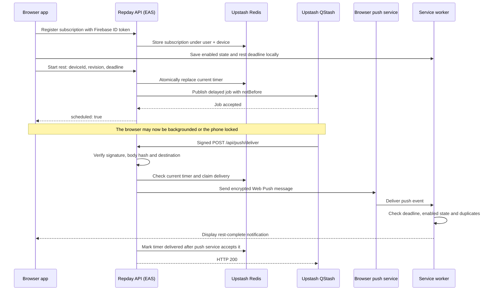

# How QStash works in Repday

QStash schedules the server request that sends a rest-complete notification. For example, when a user starts a 90-second rest, Repday asks QStash to call its delivery API after those 90 seconds. The browser does not have to stay open for that server request to happen.

QStash is the scheduler and HTTP delivery service. Repday's API sends the encrypted Web Push message, and the browser's service worker displays the notification. Scheduling a job successfully does not guarantee that the phone will display an alert at the exact deadline.

## Responsibilities

| Component | Responsibility |
| --- | --- |
| Browser app | Requests notification permission, registers the browser subscription, and reports timer changes. |
| Firebase Authentication | Identifies the user making subscription and timer requests. |
| Expo Router APIs on EAS Hosting | Validate requests, schedule jobs, verify callbacks, and send Web Push messages. |
| Upstash Redis | Stores the browser subscription and the current timer state. |
| Upstash QStash | Holds the delayed job and calls the delivery API when it becomes due. |
| Browser push service | Accepts an encrypted notification for the subscribed browser. |
| Service worker (`public/sw.js`) | Checks local timer state, displays the notification, and opens Repday when it is tapped. |

Redis and QStash are separate Upstash services with separate credentials. Firestore continues to store workout data; this feature stores its delivery state in Redis.

## Request flow



The push service's acceptance and the phone's eventual display are separate steps. Repday marks a job delivered after acceptance; it does not receive confirmation that the user saw the notification.

## 1. Enabling alerts

The user presses **Enable** on the workout or profile screen. `lib/restPush.web.ts` requests permission, registers `/sw.js`, obtains a Push API subscription, and sends it to `POST /api/push/subscription`.

That request contains a Firebase ID token, a browser-generated device UUID, and the subscription's endpoint and encryption keys. The API verifies the token, validates the subscription, and stores it under the authenticated UID. Browser permission alone is insufficient: server registration must also succeed.

On iPhone/iPad, the UI instructs users to add Repday to their Home Screen and launch it there before enabling alerts on a supported OS.

## 2. Scheduling a rest

When `restEndsAt` changes, the browser updates the service worker's local state and sends this shape to `POST /api/push/timer`:

```ts
{
  deviceId: "<browser UUID>",
  revision: 1792110000000, // Monotonically increasing change identifier.
  deadline: 1792110090000 // Rest end time: Unix milliseconds.
}
```

The API authenticates the user and applies `UPDATE_TIMER`, a Redis Lua script. The script accepts only a revision newer than the stored revision, updates the timer atomically, and clears the previous delivery state. An older request arriving late cannot replace a newer timer.

The server creates a new `timerId` UUID and calls `enqueueRestAlert()` in `lib/server/webPush.ts`:

```ts
await queue.publishJSON({
  url: `${config.origin}/api/push/deliver`,
  body: { uid, deviceId, timerId, deadline },
  notBefore: Math.ceil(deadline / 1000),
  retries: 2,
  deduplicationId: timerId,
});
```

The browser/Redis deadline uses **milliseconds**. QStash's `notBefore` uses **seconds**. Rounding upward prevents intentionally scheduling the callback before the deadline.

The QStash payload contains identifiers and a deadline. It does not contain the Firebase ID token, browser subscription keys, VAPID private key, or workout details.

After QStash accepts the job, the API returns `{ ok: true, scheduled: true }`. The UI then shows **Rest alert scheduled**. If publishing fails, the API invalidates that timer and returns an error instructing the user to keep Repday open.

## 3. Receiving the callback

At or after `notBefore`, QStash sends a signed HTTP POST to `/api/push/deliver`.

`verifyPushDelivery()` uses the QStash SDK's `Receiver` to verify:

- The `Upstash-Signature` header against the current or next signing key.
- The hash of the exact, unmodified request body.
- The callback destination against `${WEB_PUSH_ORIGIN}/api/push/deliver`.

The callback does not use a Firebase token. It is authenticated as a QStash delivery using its signature instead. Invalid or unsigned requests are rejected before Redis state or push delivery is accessed.

The API then runs `CLAIM_TIMER` atomically. It skips a job if its timer ID is no longer current, it was already delivered, its deadline has not arrived, or it is more than 60 seconds late. Otherwise, it claims a 15-second delivery lease and reads the stored browser subscription.

After another current-timer check, `sendRestPush()` encrypts and signs the Web Push message using the VAPID keys and sends it to the browser's push endpoint. Only approved browser push hosts are accepted, and redirects are disabled.

## 4. Cancellation and replacement

**Repday invalidates queued jobs rather than deleting them from QStash.** The old callback may still arrive, but it will see that its timer ID is no longer current and return HTTP 200 without sending a push.

| User action | What happens |
| --- | --- |
| Reset rest | A newer revision and timer ID replace the old timer; a new QStash job is published. |
| Skip rest | The browser sends `deadline: null`; Redis clears the current timer ID. |
| Finish or discard workout | The effective rest deadline becomes null, cancelling the current alert. |
| Sign out | The hook attempts to cancel the timer with its cached token and disables local worker alerts. |
| Turn alerts off | The API deletes this user/device subscription record; the browser unsubscribes. |
| Pause workout | Workout elapsed time pauses, but rest continues, matching the existing timer behaviour. |

The service worker also checks its locally stored enabled state and deadline. This helps suppress a stale push after a local skip or reset, even if the cancellation request has not reached the server yet. A notification already being delivered cannot be reliably recalled.

Skipped or replaced jobs still consume scheduled-message usage. Cancellation in this implementation is not a refund or removal of the QStash message.

## 5. Retries and duplicate delivery

Jobs are published with **two retries**. The implementation treats callbacks as potentially duplicated rather than assuming exactly-once delivery.

| Callback outcome | HTTP response | Behaviour |
| --- | --- | --- |
| Push service accepts the message | 200 | Mark the timer delivered. |
| Job was cancelled, replaced, already delivered, or is stale | 200 | Acknowledge and skip it. |
| Another delivery holds the lease | 503 | Allow a retry. |
| Redis or push delivery fails temporarily | 503 | Release the lease when possible and allow a retry. |
| Push service returns 404 or 410 | 200 | Remove the matching expired subscription and stop retrying it. |
| Invalid signature | 401 | Reject the request. |
| Signed but malformed payload | 400 | Reject the request. |

`FINISH_TIMER` marks successful delivery only if the timer is still current. On a delivery failure, it clears the lease so a retry can try again. If a process stops unexpectedly, the lease expires after 15 seconds.

The service worker additionally remembers the last handled timer ID to suppress duplicates. A crash between push-service acceptance and the Redis update can still cause another send attempt; these checks reduce duplication without claiming an exactly-once guarantee.

## Redis state

Each browser/account registration uses a hash:

```text
repday:push:<firebaseUid>:<deviceId>
```

| Field | Meaning |
| --- | --- |
| `subscription` | JSON browser push endpoint and encryption keys. |
| `revision` | Latest accepted browser timer-change identifier. |
| `timerId` | Current scheduled timer UUID; empty when cancelled. |
| `deadline` | Current rest end time in Unix milliseconds; zero when cancelled. |
| `lease` | Temporary delivery claim expiry in Unix milliseconds. |
| `delivered` | Timer ID already accepted by the push service. |

Registration and timer updates refresh a **90-day expiry** on the hash. Opt-in is specific to the account and browser; the implementation does not broadcast to every device signed into the account.

## Configuration

All variables below belong in the server environment. Do not give private values an `EXPO_PUBLIC_` prefix or commit them to Git.

| Variable | Purpose |
| --- | --- |
| `QSTASH_TOKEN` | Authorises publishing jobs to QStash. |
| `QSTASH_CURRENT_SIGNING_KEY` | Verifies incoming callbacks. |
| `QSTASH_NEXT_SIGNING_KEY` | Supports verification during signing-key rotation. |
| `UPSTASH_REDIS_REST_URL` | Existing Redis REST endpoint. |
| `UPSTASH_REDIS_REST_TOKEN` | Existing Redis access credential. |
| `WEB_PUSH_ORIGIN` | Exact public HTTPS origin of this deployment, without a trailing slash. |
| `WEB_PUSH_PUBLIC_KEY` | VAPID public key returned to browsers by `GET /api/push`. |
| `WEB_PUSH_PRIVATE_KEY` | Secret VAPID signing key. |
| `WEB_PUSH_SUBJECT` | Public contact URL or `mailto:` address identifying the sender. |

Firebase's existing web API key is also required for user-token verification. `npm run push:keys` generates the VAPID pair in ignored `.env.local`; reuse that pair across deployments.

In the Expo project dashboard, add these under **Project settings → Environment variables** for `production`. Use **Sensitive** visibility for QStash credentials, Redis credentials and the VAPID private key; public values may use **Plain text**. EAS Hosting does not support **Secret** visibility. See [Expo environment-variable usage](https://docs.expo.dev/eas/environment-variables/usage/#using-environment-variables-with-eas-hosting).

Local environment values do not configure EAS production. Add the variables to the appropriate EAS environment and redeploy the web/API build. QStash must be able to reach the callback over public HTTPS; it cannot call a developer's private localhost address. Preview deployments must use their own callback origin and appropriate isolated configuration.

See [Web Push setup](web-push.md#activate-in-production) for the activation checklist.

## Limits and troubleshooting

- Timer and subscription requests share a **60 requests/minute per-account** rate limit.
- The scheduling API accepts rest deadlines up to **30 minutes** ahead.
- The server and worker discard alerts more than **60 seconds late**; push-service TTL is also 60 seconds.
- Web Push needs connectivity and notification permission. Delivery can be delayed or suppressed by browser/phone settings. It is not an exact or offline alarm.
- If the UI says alerts are unavailable, check the required environment variables and redeploy.
- If scheduling fails, inspect QStash publishing errors, Redis availability, and the deployment origin.
- If callbacks return 401, check both signing keys, the exact callback URL, and whether anything modified the body before signature verification.
- HTTP 200 with `Skipped` can be expected after reset/skip, duplicate delivery, or expiry. It is not proof that a phone displayed an alert.
- A successful QStash callback confirms server processing. To verify the entire feature, test notification display on an actual phone, including locking it during rest.

## Verification commands

```sh
# Validation, callback-signature and worker tests; Redis integration is skipped.
npm run test:push

# Also exercise actual Redis Lua scripts using disposable qa-push-* records.
# Firebase verification, QStash publishing and the push service remain mocked.
RUN_PUSH_REDIS_TESTS=1 npm run test:push

# Export the production web app and API routes.
npm run export:web
```

These automated checks do not prove real QStash-to-phone delivery. See [the recorded verification limits](web-push.md#checks) and perform the physical-device checks before promising locked-screen alerts.

## Production activation check — 2026-10-16

The feature was deployed to `https://repday.expo.app`. Readiness, service-worker and manifest endpoints returned HTTP 200, and unsigned callbacks were rejected. A real three-second QStash test job was recorded as **DELIVERED** after the signed callback was processed. The job referenced a nonexistent subscription, so the API acknowledged it without sending a notification. This verifies QStash publishing, public callback reachability, signature verification and the Redis lookup path; actual phone notification delivery still requires a user-device test.

## Implementation map

| File | Relevant responsibility |
| --- | --- |
| `lib/restPush.web.ts` | Subscription lifecycle, local worker state and timer synchronization. |
| `app/api/push+api.ts` | Configuration readiness and public VAPID key. |
| `app/api/push/subscription+api.ts` | Authenticated subscription registration/removal. |
| `app/api/push/timer+api.ts` | Timer validation, revision fencing and job publishing. |
| `app/api/push/deliver+api.ts` | Signed callback handling and delivery outcomes. |
| `lib/server/webPush.ts` | QStash client/receiver, Redis scripts, authentication and Web Push transport. |
| `public/sw.js` | Local cancellation/duplicate checks, notification display and click handling. |
| `tests/web-push.test.ts` | Validation, signatures, Redis state transitions and worker checks. |

Official references: [QStash delayed delivery](https://upstash.com/docs/qstash/features/delay), [QStash callback verification on Workers](https://upstash.com/docs/qstash/quickstarts/cloudflare-workers), [Web Push API](https://developer.mozilla.org/en-US/docs/Web/API/Push_API).
