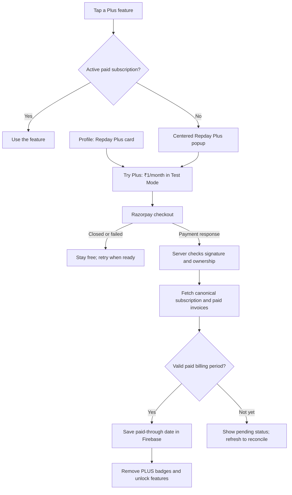

# Repday Plus: subscription and feature-access flow

Updated: 16 October 2026 (Asia/Kolkata).

## Current state

The integration is implemented and testable locally at `http://localhost:8081`.
Razorpay is restricted to **Test Mode**, using a **₹1/month simulated plan**.
No real money is charged. The intended launch price is ₹200/month; switching to
live billing requires a separate plan and an explicit implementation change.

This document is being published separately from the local implementation.
The billing code, gold button styling, hosted billing environment, new Firestore
rules, and Razorpay dashboard webhook registration have not been released to
production as part of this documentation update.

## What is free and what requires Plus?

| Feature | Free account | Active Plus subscription |
| --- | --- | --- |
| Workout tracking and history | Available | Available |
| Saved workout splits | Up to 6 | More than 6 |
| AI Coach | Requires subscription | Available |
| Form Inspection | Requires subscription | Available |

Existing splits remain readable and editable after subscription expiry, including
libraries containing more than six splits. A free user cannot add another split
if the resulting library would exceed six. Imports and generated training plans
follow the same rule; the limit is not merely a disabled UI button.

## The user journey

1. **Discover Plus.** AI Coach and Form Inspection have gold buttons. Split
   creation becomes a Plus action when the free allowance is exhausted. A small
   **PLUS** badge is visible for users without an active paid subscription.
2. **Open the paywall.** Tapping a locked feature opens a centered popup over a
   dimmed view of the app. The user can close it with **×**, tap outside, or use
   the platform's back action. The Profile page also contains the subscription
   card directly.
3. **Review the offer.** The popup shows the current ₹1/month sandbox price,
   included features, and a clear Test Mode notice.
4. **Start checkout.** The server authenticates the Firebase user and creates or
   reuses a pending Razorpay subscription for the configured plan. The client
   receives only the public key ID, subscription ID, and checkout prefill email.
5. **Authorize the test payment.** Razorpay handles card/payment details. Repday
   never stores card numbers or CVVs. Use Razorpay's documented test credentials,
   not a real card, while testing.
6. **Verify on the server.** A checkout success response is not sufficient to
   grant access. The server verifies the signature against the subscription ID
   stored for that signed-in user, then fetches the subscription and paid invoices.
7. **Unlock Plus.** A valid paid invoice supplies the access expiry date. The app
   updates the subscription status, removes PLUS badges, and closes the paywall
   on a successful purchase. The user can then tap the intended feature again.
   Buying from Profile updates the inline subscription card.
8. **Keep the gold identity.** Gold identifies Plus features even for subscribers;
   the PLUS badge disappears when subscribed. Free features retain their normal
   theme styling.

## What the server verifies

- Every billing or split request authenticates a Firebase ID token. The UID comes
  from the verified account, not a client-provided UID.
- Live Razorpay keys are refused. The plan is checked as monthly, interval 1,
  currency INR, and amount 100 paise before creating a subscription.
- Checkout verification uses HMAC-SHA256 over
  `payment_id + "|" + server_stored_subscription_id`.
- The Razorpay subscription must belong to the verified Firebase UID and match
  the configured plan.
- Access is based on fully paid ₹1 INR invoices and their `billing_end`, not a
  browser success message, an editable settings field, or mandate authorization
  alone.
- A server transaction serializes split creation and checks the actual stored
  library count, so concurrent requests cannot both claim the sixth free slot.
- AI Coach checks access before calling the model.
- Form Inspection checks access before opening the camera. Its analysis runs
  on-device; downloaded client code is not a security boundary against modified
  clients.

## Firebase records

| Path | Purpose | Client access under the staged rules |
| --- | --- | --- |
| `billingAccounts/{uid}` | Current subscription, provider status, paid-through date, cancellation state | Owner reads; server writes |
| `billingSubscriptions/{subscriptionId}` | Bind a Razorpay subscription to its Firebase owner | Server only |
| `billingEvents/{eventDigest}` | Deduplicate signed webhook deliveries | Server only |
| `splitQuotas/{uid}` | Transaction guard for split creation | Server only |
| `users/{uid}/splits/{splitId}` | Editable workout split data | Owner reads/updates/deletes; server creates |

Billing status is separate from ordinary user settings so clients cannot grant
paid access to themselves. The rules enforcing server-only split creation are
staged locally and still need deployment.

## API responsibilities

| Endpoint | What it does |
| --- | --- |
| `GET /api/billing` | Return status and reconcile an existing subscription with Razorpay |
| `POST /api/billing/subscribe` | Create or reuse a sandbox subscription |
| `POST /api/billing/verify` | Verify checkout signature, reconcile invoices, return status |
| `POST /api/billing/access` | Check access before entering a Plus feature |
| `POST /api/billing/cancel` | Cancel renewal, retaining already-paid access |
| `POST /api/billing/delete-account` | Cancel a mandate immediately before account deletion |
| `POST /api/billing/webhook` | Process signed provider lifecycle events |
| `POST /api/splits` | Save splits atomically with a server-side quota check |

All user endpoints require authentication. The webhook authenticates the provider
using a separate webhook signing secret and the exact raw request body.

## Renewal, cancellation, and expiry

**Renewal:** Razorpay performs subsequent monthly charges. A signed subscription
webhook prompts the server to fetch canonical provider state and paid invoices.
It updates the paid-through date. Duplicate deliveries are deduplicated, and
old events cannot overwrite a replacement subscription.

**Cancellation:** Profile offers **Cancel subscription**, followed by a confirmation.
An active subscription is cancelled at the end of its billing cycle. Repday
records the accepted cancellation itself because Razorpay's generic scheduled-
changes flag does not reliably indicate scheduled cancellation. Paid access
remains until the paid-through date; cancellation does not issue a refund.

**Expiry or failed renewal:** Without a new paid invoice, access expires at the
stored paid-through date. Server checks reject Plus requests even if the provider
status still says active. Workout history and existing splits remain available.

**Account deletion:** The user reauthenticates first. Repday cancels an outstanding
mandate immediately before deleting workout data and Firebase Auth, so renewal
cannot continue for a deleted account. Server-owned billing audit records may
remain; they do not contain card details.

## Interrupted and delayed flows

- Closing checkout leaves the user free and permits retrying the pending checkout.
- A failed test payment displays an error and permits retrying.
- A mandate may be authorized before an invoice is paid. This does not grant Plus.
- If provider invoices are still updating, use **Refresh subscription status**.
  Refresh reconciles canonical Razorpay records rather than trusting cached UI.
- Webhooks with invalid signatures are rejected. A valid event whose subscription
  mapping is not ready returns an error so Razorpay can retry it.

## What still needs to happen before hosted rollout

1. Configure the server-only Test Mode keys, plan, webhook secret, Firebase admin
   credential, and `BILLING_ENABLED=true` in the hosted environment.
2. Deploy the new web client and API and verify the active production version.
3. Deploy the staged Firestore rules and verify denied client split creation and
   billing writes. Older app versions create splits directly and need a refresh.
4. Register the Test Mode webhook at
   `https://repday.expo.app/api/billing/webhook` with the matching signing secret.
5. Test dashboard-triggered renewals and failed-payment retries. Razorpay cannot
   reach localhost directly; local webhook delivery needs an HTTPS tunnel.
6. Keep live billing disabled until a deliberate live launch with the ₹200 plan,
   required policy pages, and revised Test Mode-only safeguards.

## Verification already completed locally

- A complete simulated card payment, server invoice verification, Plus activation,
  disappearance of the Coach badge, and saving a seventh split.
- Cycle-end cancellation with paid access retained, followed by immediate
  cancellation for test-account cleanup.
- Signed webhook handling, duplicate delivery, invalid signatures, and a
  concurrent free split-creation race.
- Centered-popup layout, dismissal, and badge behavior in light, dark, and
  Cyberpunk themes at 393px, 466px, and 1280px widths.
- TypeScript, web export, billing lifecycle tests, and checks that server secrets
  are absent from browser assets. Physical iPhone testing remains unverified.

## Official references

- [Razorpay subscription integration](https://razorpay.com/docs/payments/subscriptions/integration-guide/)
- [Razorpay sandbox testing and test cards](https://razorpay.com/docs/payments/subscriptions/test/)
- [Webhook validation](https://razorpay.com/docs/webhooks/validate-test/)
- [Subscription cancellation](https://razorpay.com/docs/api/payments/subscriptions/cancel-subscription/)
