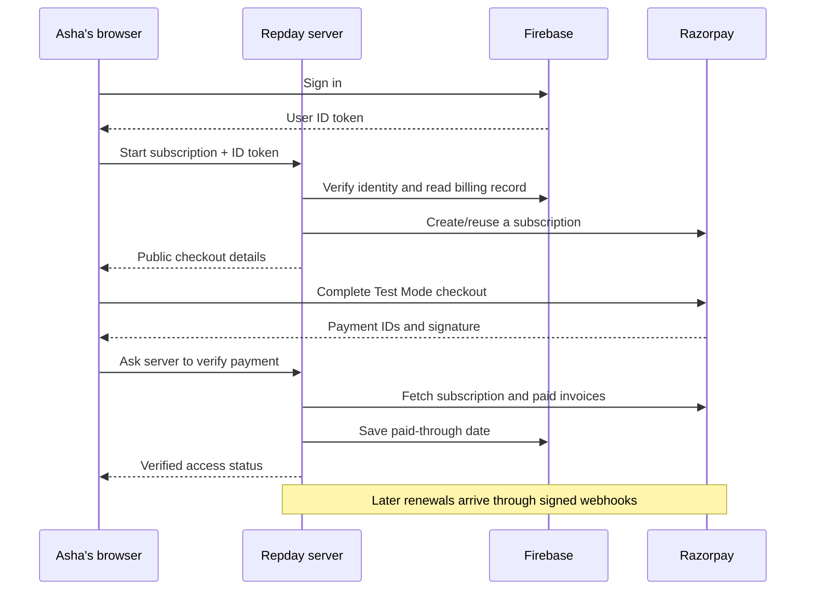

# Implementing subscriptions with Razorpay and Firebase: a beginner's guide

Updated: 17 October 2026 (Asia/Kolkata).

**Current production correction:** billing now uses version-conditional Firestore
commits instead of the billing transaction sequences described in the original
walkthrough below. Status reads do not reconcile provider invoices; signed
payment verification and webhooks do. See the
[hosting request-budget incident and current flow](billing-worker-subrequest-incident.md)
for the measured 10-fetch limit, current implementation and verification.
These changes have been deployed to the hosted web app. The publication and
deployment notes below describe earlier stages of the project.

This guide is for a developer who can build a basic website and sign users in,
but has never implemented subscription payments. It explains what to build,
why each part exists, where it belongs, and how to check that it works.

We use Repday as the example: workout tracking and six saved splits are free;
AI Coach, Form Inspection, and additional splits require Repday Plus.
Development uses a **₹75/month Razorpay Test Mode plan**. Payments are simulated.
The intended launch price is ₹75/month, but live billing is not enabled.

## Read this before following the commands

There are two different things in this repository right now:

- **Published documentation:** this guide is on GitHub.
- **Local implementation:** the payment modules and scripts described below exist
  in the current development workspace. They have not yet been committed and
  pushed with this documentation, or deployed to the hosted website.

If you cloned the documentation-only GitHub version, check for
`lib/server/billing.ts` and `scripts/setup-razorpay-sandbox.mjs` before running
payment commands. If they are missing, you need the implementation version first.
Do not assume a successful Git clone includes unpublished local code.

The main path below explains the existing Repday implementation. Code blocks
marked **excerpt** explain an existing module; they are not additional files to
paste over it. Blocks marked **pseudocode** show the order of operations and are
not runnable programs. If adapting this design to a different website, use your
framework's server routes and database adapter in the same roles.

This guide does not install packages, change credentials, or deploy anything
just by being read. Run commands from the project root when you reach their step.

## Contents

1. [Learn the five pieces](#1-learn-the-five-pieces)
2. [Choose the subscription rules](#2-choose-the-subscription-rules)
3. [Prepare your development environment](#3-prepare-your-development-environment)
4. [Create Razorpay Test Mode credentials](#4-create-razorpay-test-mode-credentials)
5. [Give the server access to Firebase](#5-give-the-server-access-to-firebase)
6. [Create a monthly plan](#6-create-a-monthly-plan)
7. [Design the billing records](#7-design-the-billing-records)
8. [Authenticate API requests](#8-authenticate-api-requests)
9. [Create one subscription per customer](#9-create-one-subscription-per-customer)
10. [Open checkout from the browser](#10-open-checkout-from-the-browser)
11. [Verify the result and unlock access](#11-verify-the-result-and-unlock-access)
12. [Enforce paid features and the free limit](#12-enforce-paid-features-and-the-free-limit)
13. [Handle renewals with webhooks](#13-handle-renewals-with-webhooks)
14. [Handle cancellation, expiry, and account deletion](#14-handle-cancellation-expiry-and-account-deletion)
15. [Test the complete lifecycle](#15-test-the-complete-lifecycle)
16. [Deploy the sandbox integration safely](#16-deploy-the-sandbox-integration-safely)
17. [Prepare a separate live launch](#17-prepare-a-separate-live-launch)
18. [Troubleshoot common problems](#18-troubleshoot-common-problems)

## 1. Learn the five pieces

Imagine a customer called Asha wants to subscribe to Repday Plus.

| Piece | What it does | What it must not decide |
| --- | --- | --- |
| Browser/frontend | Shows the offer, opens checkout, displays access status | Whether Asha has actually paid |
| Your server/backend | Verifies identity and payments, stores billing state, enforces limits | Payment details invented by the browser |
| Firebase Authentication | Identifies Asha with a unique user ID, called a UID | Whether a subscription invoice is paid |
| Firestore database | Stores workout data and the server's billing records | A browser-editable `premium: true` setting |
| Razorpay | Collects authorization, processes scheduled charges, reports payment state | Which Repday user owns a subscription without your mapping |

**Frontend** means code delivered to the browser. A user can inspect or modify it.
**Backend** means code running on your server. Secret credentials belong here.
**API endpoint** means a URL the browser or another service calls to ask your
server to do something, such as `/api/billing/subscribe`.

A **plan** defines the price and frequency. A **subscription** connects one
customer to that plan. A **payment** is an individual charge. An **invoice**
describes the bill for a particular period. An **entitlement** means permission
to use a paid feature. A **mandate** is permission for future recurring charges;
authorizing it does not always mean the first subscription bill has been paid.

A **webhook** is a request Razorpay sends to your server when something changes,
even if the customer's browser is closed. **Idempotent** means repeating the
same operation does not accidentally repeat its effect.



**Checkpoint:** explain why a green “payment successful” message in a browser
cannot, by itself, be the authority for paid access.

## 2. Choose the subscription rules

Write the business rules before writing checkout code. Otherwise the payment
button may work while the rest of the product behaves inconsistently.

Repday's current rules are:

| Decision | Current choice |
| --- | --- |
| Sandbox price | ₹75/month, represented as 7500 paise |
| Intended live price | ₹75/month, represented as 7500 paise |
| Free features | Workout tracking, history, up to six saved splits |
| Plus features | AI Coach, Form Inspection, more than six splits |
| Free trial | None implemented |
| Cancellation | Stop renewal; retain the already-paid period |
| After expiry | Keep history and existing splits; restrict paid features and new splits beyond six |
| Refund | Not performed by the cancellation button |

A month is not necessarily 30 days. Use the billing period supplied by the
provider rather than calculating `today + 30 days` yourself.

Example: Asha pays for a period ending on 16 November and cancels on 20 October.
She can still use Plus until the paid period ends. If she does not renew, Plus
expires then. Her workout history is not erased.

**Checkpoint:** you should know exactly what subscribing, cancelling, and
expiring do before implementing any of those actions.

## 3. Prepare your development environment

For this project you need:

- A local checkout containing the payment implementation, a supported Node.js
  runtime, and npm. The setup scripts use `process.loadEnvFile`; Node 24 was
  used during local verification.
- A Firebase project with Authentication and a Firestore database.
- A working sign-in flow. Payment ownership depends on a verified signed-in user.
- A Razorpay account with access to Test Mode and Subscriptions.
- Upstash Redis REST credentials. This project's billing API uses Redis to limit
  repeated requests; an unconfigured Redis connection will block these requests.

Install this project's dependencies:

```sh
npm ci
```

Create `.env.local` only if it does not already exist. Use `.env.example` to see
which variable names are needed; do not overwrite an existing working environment
file. Populate the Firebase public configuration and the server credentials you
configure in the next steps.

Check that secret files are ignored before adding credentials:

```sh
git check-ignore .env.local .firebase-admin.local.json
```

The command should identify those paths as ignored. The current `.gitignore`
also ignores downloaded files matching `*-firebase-adminsdk-*.json`.

| Configuration | Browser may receive it? |
| --- | --- |
| Firebase web app configuration | Yes; access is protected by Auth and Security Rules |
| Razorpay Key ID | Yes; checkout needs it |
| Razorpay Key Secret | No |
| Webhook signing secret | No |
| Firebase service-account private key | No |
| Redis REST token | No |

In Expo, `EXPO_PUBLIC_` variables are intended for client code. Never put that
prefix on a payment secret or Firebase admin credential.

**Checkpoint:** you can sign in to the app, and Git ignores your secret files.

## 4. Create Razorpay Test Mode credentials

1. Open the Razorpay dashboard and select **Test Mode**.
2. Open the API Keys area under Account & Settings; dashboard labels may change.
3. Generate a key pair and save the Key ID and its matching Key Secret.
4. Add them to `.env.local`. Replace the placeholders below with the real **test**
   values locally; do not paste secrets into chat or commit them.

```dotenv
RAZORPAY_MODE=test
RAZORPAY_KEY_ID=rzp_test_REPLACE_WITH_YOUR_TEST_KEY_ID
RAZORPAY_KEY_SECRET=REPLACE_WITH_THE_MATCHING_TEST_SECRET
BILLING_ENABLED=false
```

`BILLING_ENABLED` is Repday's enforcement switch. `false` means the server does
not require a subscription for the gated features. It does not mean “use fake
money”; Razorpay's Test Mode controls that separately. Turn enforcement on only
when the local configuration is ready to test it.

The current implementation explicitly refuses `rzp_live_` credentials. This is
an intentional guard for the development stage.

If you regenerate keys, replace both values together. A masked dashboard value
such as `********` is not a usable secret.

**Checkpoint:** your Key ID starts with `rzp_test_` and you have its actual,
matching secret stored only in the server environment.

## 5. Give the server access to Firebase

The browser signs in as Asha and can access only her permitted data. The server
needs a separate administrative credential to write billing state that Asha is
not allowed to edit herself.

For the existing Repday implementation:

1. Open Firebase Console and select the same project used by the app.
2. Open **Project settings → Service accounts → Firebase Admin SDK**.
3. Generate and download a private-key JSON file.
4. Keep the file local and ignored by Git.
5. Run the setup command with the path to your downloaded file:

```sh
npm run billing:firebase -- /absolute/path/to/your-service-account.json
```

The helper checks the project ID, copies the file to
`.firebase-admin.local.json`, and writes its compact JSON value to
`FIREBASE_ADMIN_SERVICE_ACCOUNT` in `.env.local`. It uses owner-only file
permissions and does not print the private key.

Repday uses `lib/server/firebaseAdmin.ts`, a server-only Firestore REST adapter.
It exchanges the service-account credential for an access token and uses that
token to access Firestore. The private credential is never sent to the browser.
Administrative access bypasses client Security Rules, which is why the server
must still authenticate users and validate the requests it receives.

For a different Node.js website, Firebase's Admin SDK can provide the equivalent
server access. That is an alternative adapter, not an extra dependency required
by Repday. Follow the [official server setup guide](https://firebase.google.com/docs/admin/setup)
and [ID-token verification guide](https://firebase.google.com/docs/auth/admin/verify-id-tokens)
for that approach.

After setup, this read-only check confirms the server can reach Firestore:

```sh
node --import tsx --input-type=module <<'NODE'
process.loadEnvFile('.env.local');
const imported = await import('./lib/server/firebaseAdmin.ts');
const admin = imported.default || imported;
await admin.readDocument('billingAccounts/setup-check');
console.log('Firebase server authentication and Firestore read access work.');
NODE
```

The check does not create a record. A missing `setup-check` document is fine;
the purpose is to prove that authenticated server access succeeds.

**Checkpoint:** the setup command reports success for the expected Firebase
project and the read-only check completes without an authentication error.

## 6. Create a monthly plan

Create the plan once, then reuse its ID for each customer's subscription. Do not
create a fresh plan every time someone clicks Subscribe.

Run:

```sh
npm run billing:setup
```

This helper uses the Test Mode keys to validate the configured plan or create a
monthly ₹75 plan. It saves `RAZORPAY_PLAN_ID`, sets `RAZORPAY_MODE=test`, and creates
a separate random `RAZORPAY_WEBHOOK_SECRET` if one is missing.

The request the setup script makes has this shape; this is a **request example**,
not another command you need to run after the helper:

```json
{
  "period": "monthly",
  "interval": 1,
  "item": {
    "name": "Repday Plus — sandbox",
    "amount": 100,
    "currency": "INR"
  }
}
```

Razorpay returns an ID beginning with `plan_`. The server later uses that ID to
create subscriptions. The browser must not choose the price or the plan ID.

See the [official plan API](https://razorpay.com/docs/api/payments/subscriptions/create-plan/)
for a new implementation. Repday's amount validation is deliberately fixed to
7500 paise while sandbox development is in progress.

**Checkpoint:** the helper prints a sandbox plan ID and confirms ₹75/month.
A 401 response usually means the key pair is invalid or mismatched.

## 7. Design the billing records

Keep billing separate from ordinary editable profile settings.

| Firestore path | What to store | Who writes it |
| --- | --- | --- |
| `billingAccounts/{uid}` | Current subscription ID, status, paid-through time, cancellation state, optional manual Plus grant | Server or trusted Firebase administrator |
| `billingSubscriptions/{subscriptionId}` | The Firebase UID that owns this subscription | Server |
| `billingEvents/{eventDigest}` | Which webhook deliveries were already handled | Server |
| `splitQuotas/{uid}` | A revision used to serialize split-creation transactions | Server |
| `users/{uid}/splits/{splitId}` | Workout content and its display position | Server creates; owner can edit/delete |

An **illustrative billing record** looks like this. These IDs are placeholders:

```json
{
  "subscriptionId": "sub_EXAMPLE",
  "status": "active",
  "paidUntil": 1794801600000,
  "cancellationScheduled": false,
  "mode": "test"
}
```

`paidUntil` is a Unix timestamp in **milliseconds**. JavaScript's `Date.now()`
uses milliseconds. Razorpay's invoice `billing_end` uses seconds, so the server
converts it by multiplying by 1000.

Do not let the browser write `paidUntil` or `manualPlusAccess`. The server
derives current access from a verified paid period or an administrator's grant:

```ts
const premium = manualPlusAccess === true || (typeof paidUntil === 'number' && paidUntil > Date.now());
```

The browser may cache this answer for display, but the server must check it again
when a protected API is called.

**Checkpoint:** you can name the server-owned billing record for any Firebase UID
and explain why the user's normal settings cannot grant paid access.

## 8. Authenticate API requests

The user first signs in through Firebase Auth. When the browser calls your API,
it sends the signed-in user's ID token. The token is evidence the server must
verify; a plain `{ uid: "someone" }` request body is not proof of identity.

**Browser excerpt** from the approach in `backend/billing.ts`:

```ts
const user = auth.currentUser;
if (!user) throw new Error('Sign in first.');

const token = await user.getIdToken();
const response = await fetch('/api/billing/subscribe', {
  method: 'POST',
  headers: {
    Authorization: `Bearer ${token}`,
    'Content-Type': 'application/json',
  },
  body: JSON.stringify({}),
});
```

`auth` above is the Firebase client Auth instance exported by this project's
`backend/firebase/client.ts`. This is web same-origin code; native clients use the
configured API origin through `getApiBaseUrl()` instead.

**Server excerpt** using the existing Repday helper:

```ts
const { uid, email } = await billingUser(request);
```

`billingUser` lives in `lib/server/billingAuth.ts`. It checks the bearer token with
Firebase, rejects missing/invalid/disabled accounts, and applies a per-user
Redis request limit. Only its verified UID is used to select billing records.

A different backend can verify the token with Firebase Admin's `verifyIdToken()`.
Do not merely decode the token's JSON without verifying it.

**Checkpoint:** an API call without a token returns 401; a valid signed-in request
can reach your subscription handler. Never log the bearer token while testing.

## 9. Create one subscription per customer

Implement `POST /api/billing/subscribe`. Its job is to prepare checkout, not to
mark the user as paid.

The order of work is:

1. Authenticate the user.
2. Read `billingAccounts/{uid}`.
3. Reuse a still-pending subscription if one already exists.
4. Reject a second purchase if a usable subscription is already active.
5. Otherwise reserve creation with a short-lived server-side lease.
6. Fetch and validate the configured plan's amount, currency, and monthly interval.
7. Create the Razorpay subscription using server credentials.
8. Save both the user's current subscription ID and the subscription-to-UID mapping.
9. Return only the public checkout details to the browser.

A **server request example** from Repday's implementation:

```ts
const subscription = await razorpay('subscriptions', {
  plan_id: process.env.RAZORPAY_PLAN_ID,
  total_count: 120,
  quantity: 1,
  customer_notify: 1,
  notes: { firebase_uid: uid },
});
```

Here, `razorpay` is the server-only REST helper in `lib/server/billing.ts`. It
adds HTTP Basic authentication using the server's key pair. Never move this
function or the Key Secret into a browser component.

`total_count: 120` means the configured subscription has at most 120 monthly
billing cycles. It is a provider setting, not an infinite renewal promise.
The UID in `notes` is an additional server-created ownership check.

A **response example** contains no secret:

```json
{
  "subscriptionId": "sub_EXAMPLE",
  "keyId": "rzp_test_EXAMPLE",
  "email": "customer@example.com",
  "mode": "test"
}
```

Why the lease? Two quick clicks can produce two simultaneous API requests. A
normal “check then create” sequence can create two subscriptions. A transaction
and a short-lived reservation prevent both requests creating a new one together.
The current implementation also tries to cancel a newly created orphan if saving
its mapping fails. This cleanup still needs monitoring if either service is down.

**Checkpoint:** clicking Subscribe again reuses a pending subscription rather than
creating another mandate. Merely creating a subscription does not unlock Plus.

## 10. Open checkout from the browser

Razorpay supplies the checkout UI. Repday supplies the public key and the
server-created subscription ID. Load checkout only when the user asks to buy.

The following is a **simplified browser excerpt**. The complete implementation
in `backend/billing.ts` handles script loading, errors, dismissal, and verification:

```ts
// Run after https://checkout.razorpay.com/v1/checkout.js has loaded.
type CheckoutDetails = {
  subscriptionId: string;
  keyId: string;
  email: string;
  mode: 'test';
};
const details = await billingRequest<CheckoutDetails>('/api/billing/subscribe', {});

// The cast is needed unless your TypeScript project declares the script's types.
const checkout = new (window as any).Razorpay({
  key: details.keyId,
  subscription_id: details.subscriptionId,
  name: 'Repday Plus',
  image: 'https://repday.expo.app/icons/repday-login-192.png',
  description: '₹75/month · Test Mode · No real money',
  prefill: { email: details.email },
  handler: async (paymentResponse: Record<string, string>) => {
    const status = await billingRequest('/api/billing/verify', paymentResponse);
    // Display the server's result; do not invent premium=true here.
    updateSubscriptionUI(status);
  },
});

checkout.open();
```

`billingRequest` is the authenticated client helper from Step 8.
`updateSubscriptionUI` is a descriptive placeholder for your UI update; Repday
uses the `useBilling` hook's `accept` function. `window.Razorpay` is supplied by
the checkout script, not by Firebase.

Repday's centered paywall is in `app/index.tsx` and uses
`components/SubscriptionPanel.tsx`. It can be dismissed with × or the backdrop.
The checkout `image` option supplies the login-screen logo. Use a publicly
reachable HTTPS image URL so Razorpay's checkout frame can load it, including
when the app is being tested on localhost. Dashboard logo settings are not
required for this explicitly configured checkout image.

Gold buttons identify Plus features. A PLUS badge appears when unsubscribed and
disappears after verified activation; the gold styling remains. Verified, unexpired
subscribers also see a gold PLUS badge on the loading animation, after their
account identity and server status are available. The loading background stays
white; free, expired, unknown, and signed-out states do not show this badge.

Closing checkout is a normal action, not a successful payment. The user stays
free and can retry. A failed payment should show an error without erasing their
workout data.

**Checkpoint:** checkout opens with ₹75 in Test Mode. Opening or dismissing it does
not change paid access.

## 11. Verify the result and unlock access

This is the most important backend step. Implement
`POST /api/billing/verify` before letting checkout unlock anything.

### 11.1 Verify the checkout signature

Checkout returns a payment ID, subscription ID, and signature. A signature lets
your server check that the payment response is authentic.

The server must:

1. Authenticate the Firebase user again.
2. Read that user's subscription ID from its own billing record.
3. Reject a response referring to a different subscription.
4. Verify the HMAC using the stored subscription ID and the server's Key Secret.

**Server excerpt** using Repday's existing Web Crypto verification helper:

```ts
const account = await readDocument(`billingAccounts/${uid}`);
const serverSubscriptionId = account?.subscriptionId;

if (!serverSubscriptionId || body.razorpay_subscription_id !== serverSubscriptionId) {
  throw new ServerError(400, 'Subscription does not match this account.');
}

const valid = await verifySignature(
  `${body.razorpay_payment_id}|${serverSubscriptionId}`,
  body.razorpay_signature,
  process.env.RAZORPAY_KEY_SECRET!,
);

if (!valid) throw new ServerError(400, 'Payment verification failed.');
```

The real route also validates the request body and ID/signature formats. Do not
substitute the browser's subscription ID for the stored ID when building the
signed message. See [Razorpay's verification instructions](https://razorpay.com/docs/payments/subscriptions/integration-guide/).

### 11.2 Confirm that the billing period was actually paid

A valid signature is not the complete access decision. Fetch the subscription
from Razorpay, check its configured plan and owner UID, then fetch its invoices.
For Repday's fixed sandbox plan, accept invoices only when they:

- Belong to this subscription.
- Have status `paid` and currency `INR`.
- Show 7500 paise paid, no amount due, and a valid `billing_end`.

Take the latest qualifying `billing_end`, convert seconds to milliseconds, and
save that as `paidUntil` in a server transaction.

```ts
await refreshSubscription(uid, serverSubscriptionId);
return billingResponse(await billingStatus(uid));
```

These are existing functions in `lib/server/billing.ts`. The refresh function
fetches canonical provider state, meaning Razorpay's current records rather than
an old browser message. It paginates invoices for this bounded subscription and
asks the client to retry if paid invoices are still catching up.

The invoice field names and endpoint are documented in the
[subscription invoices API](https://razorpay.com/docs/api/payments/subscriptions/fetch-invoices/).
The exact 100-paise comparison is Repday's sandbox policy. If you later support
taxes, discounts, multiple plans, refunds, or partial payments, redesign that
policy rather than copying this fixed-price check unchanged.

### 11.3 Update the UI

Return the server's status to the client. An **abbreviated response example**:

```json
{
  "premium": true,
  "mode": "test",
  "amountPaise": 100,
  "paidUntil": 1794801600000,
  "status": "active",
  "cancellationScheduled": false,
  "splitLimit": null
}
```

Repday saves this display state in `hooks/useBilling.ts`. The popup closes after
verified activation, badges disappear, and the user can tap the intended feature
again. Purchasing from Profile updates its inline subscription card.

If authorization succeeded but a paid invoice is not available yet, show a
pending message and allow **Refresh subscription status**. Do not fake success
by changing local storage.

**Checkpoint:** a forged signature fails, another user's subscription cannot be
claimed, and only a qualifying paid period grants access.

## 12. Enforce paid features and the free limit

### 12.1 Guard the feature on the server

Hiding a button is useful UX, but users can call an API without clicking it.
Protect the API before spending money on an AI request.

**Server excerpt**:

```ts
const { uid } = await billingUser(request);
await requirePremium(uid);
// Only now call the AI provider.
```

`requirePremium` checks the server-owned paid-through date when enforcement is
enabled. An unpaid request receives HTTP 402. Repday's `/api/coach` does this
before calling the model.

Form Inspection checks the account-scoped billing state before opening the camera.
That state is refreshed on sign-in, every four hours while the app stays open,
and on foreground when its last successful check is at least four hours old.
The known paid-through timer turns off access at expiry without a server read
on every camera press. Its analysis runs on the device, so a modified client
can bypass client-only code.
Do not describe downloaded browser code as an unbypassable paid-access boundary.

### 12.2 Enforce six splits in one transaction

Suppose Asha has five splits. She opens two tabs and creates one split in each.
If both requests separately count five and then save, she ends up with seven.

The fix is a database transaction with a shared guard document. **Pseudocode**:

```text
begin transaction
  read this user's splitQuota revision
  read this user's billing record and current split documents
  work out which requested IDs are new
  calculate the resulting split count
  if free and adding new splits would exceed six: reject the request
  write the splits and increment the shared quota revision together
commit transaction
```

The shared revision forces competing creations to conflict and retry. Count the
real database records, not a `currentCount` sent by the browser. For a bulk import
or onboarding plan, validate the whole batch before writing anything.

Repday implements this in `lib/server/splits.ts`, called by
`POST /api/splits`. All creation paths must use it: manual creation, imports,
onboarding, and rebuilt plans. Existing over-limit libraries are still editable;
new additions are restricted.

### 12.3 Stop clients bypassing the API

The database rules must prevent direct client creates and billing writes.
These are **rule excerpts**, not a replacement for the complete rules file:

```text
match /billingAccounts/{uid} {
  allow read: if request.auth != null && request.auth.uid == uid;
  allow write: if false;
}

match /users/{uid}/splits/{id} {
  allow create: if false; // The admin-backed API performs creation.
  // Owner read/update/delete rules and data validators also belong here.
}
```

Firestore allows an operation if **any matching allow rule** permits it. A broad
recursive owner-write rule elsewhere can accidentally reopen split creation.
Remove that bypass rather than assuming the narrower deny overrides it.

Repday's full `firestore.rules` is staged locally. It must be deployed and tested
before claiming the six-split limit is protected against direct client writes.
The administrative server bypasses these rules and is responsible for the quota.

**Checkpoint:** direct API calls cannot use AI Coach for free, simultaneous split
creations cannot exceed six, and deployed rules reject direct client creates.

## 13. Handle renewals with webhooks

The initial checkout callback happens while a browser is open. Next month's
renewal may happen while Asha is asleep. A webhook handles that case.

### 13.1 Build the endpoint first

Create `POST /api/billing/webhook`. It does not expect a Firebase user token,
because the caller is Razorpay. It verifies a separate webhook signature.

The important difference is the input: verify the **exact raw request body**, not
JSON that has been parsed and converted back to a string.

**Server excerpt**:

```ts
const rawBody = await request.text();
const signature = request.headers.get('x-razorpay-signature') || '';

if (!await verifySignature(rawBody, signature, process.env.RAZORPAY_WEBHOOK_SECRET!)) {
  return Response.json({ error: 'Invalid signature' }, { status: 401 });
}

const event = JSON.parse(rawBody); // Parse only after checking the signature.
```

Use a request-size limit and error handling as the real route does. A framework
that automatically consumes/parses JSON may need route-specific raw-body handling.
The webhook secret is different from the Razorpay API Key Secret.

See the [official webhook validation guide](https://razorpay.com/docs/webhooks/validate-test/).

### 13.2 Make repeated and late deliveries safe

1. Extract the subscription ID from the signed event.
2. Find its UID in `billingSubscriptions/{subscriptionId}`.
3. Use `x-razorpay-event-id`, or a payload digest fallback, to identify delivery.
4. In a transaction, check whether that event was already handled.
5. Ignore an event for a subscription that is no longer the account's current one.
6. Fetch current Razorpay subscription/invoice state and update the billing record.
7. Save the event marker in the same transaction as the billing update.
8. Return success only when processing succeeded. Return an error for a temporary
   failure so the provider can retry.

Saving the event marker first and the billing record later can lose a renewal
if the server crashes between the two writes. The transaction keeps them together.
Transaction callbacks may retry; do not place new charges, emails, or other
non-repeatable effects inside them. Repday's reconciliation does provider reads
there, not payment creation. Review [Firestore transaction behavior](https://firebase.google.com/docs/firestore/manage-data/transactions)
when implementing a different adapter.

### 13.3 Register the webhook in the dashboard

Once the endpoint is reachable over HTTPS:

1. Select **Test Mode** in Razorpay.
2. Open the Webhooks settings area and add an endpoint.
3. Enter `https://repday.expo.app/api/billing/webhook` after this API is deployed,
   or your development tunnel's HTTPS URL followed by `/api/billing/webhook`.
4. Set the signing secret to the same `RAZORPAY_WEBHOOK_SECRET` stored on that
   server. Read it locally; do not paste it into GitHub or chat.
5. Select the available subscription lifecycle events, including activated,
   charged, authenticated, pending, halted, paused, resumed, cancelled, and completed.
6. Send a test delivery and inspect its response and the billing record.

Razorpay cannot call `http://localhost:8081` on your computer directly. For local
webhook testing, a development HTTPS tunnel forwards incoming requests to port
8081. Restarting a tunnel may change its URL, requiring a dashboard update.
A hosted website and a Test Mode payment account can be used together: hosting
“production” and payment “Live Mode” are separate settings.

Manual status refresh can reconcile a local test payment before a tunnel exists,
but it is not a replacement for deployed webhooks handling unattended renewals.

**Checkpoint:** a signed delivery updates status, an invalid one is rejected, and
sending the same delivery twice does not apply it twice.

## 14. Handle cancellation, expiry, and account deletion

### Manual Plus grants for testers or staff

An owner can grant Plus without starting a Razorpay mandate. This grants the
same protected features and removes the six-split limit; it does **not** give
the account Firestore administrator permissions.

1. In Firebase Console, open **Authentication → Users** and copy the intended
   user's **UID**. Use the UID, not their email address, as the document ID.
2. Open **Firestore Database → `billingAccounts` → `{uid}`**. Create the
   document if it does not exist. Add `manualPlusAccess` with the **Boolean**
   value `true`. Keep the other fields unchanged.
3. Refresh Repday's subscription status or sign in again. The Plus panel should
   read “Complimentary” and the Plus badges should disappear.
4. To remove only the grant, change that field to Boolean `false`. If the user
   still has a paid subscription, the subscription can continue to provide
   access until its paid-through date.

The web client cannot write this field. The currently deployed Firestore rules
have no `billingAccounts` client-write match, and the staged rules explicitly
deny those writes. The server checks `manualPlusAccess === true` on every paid
API request and split-creation transaction. A string value such as `"true"`
does not grant access. Manual grants do not cancel any existing Razorpay
subscription; cancel a mandate separately if one exists.

This feature is in the local billing implementation. Until that implementation
is deployed, a grant saved in Firestore affects local development but not the
hosted Repday app.

### Cancellation

Authenticate the user, read their subscription ID from the server record, verify
ownership, then request cancellation. For an active subscription, Repday sends:

```ts
await razorpay(`subscriptions/${subscriptionId}/cancel`, {
  cancel_at_cycle_end: true,
});
```

Only show cancellation as accepted after Razorpay accepts it. Retain `paidUntil`.
Repday stores `cancellationScheduled: true` itself: its sandbox testing found the
provider's generic `has_scheduled_changes` field stayed false after an accepted
cycle-end cancellation. That observation is why the app tracks this specific
intent instead of treating the generic flag as proof.

A repeated cancellation should return the existing outcome rather than schedule
another action. Cancellation does not issue a refund. The
[provider cancellation API](https://razorpay.com/docs/api/payments/subscriptions/cancel-subscription/)
distinguishes immediate from end-of-cycle cancellation.

### Expiry and failed renewal

Use the paid-through timestamp on every protected server request. The server
caches the billing account in Redis for up to four hours, capped at that
timestamp, so an AI Coach message does not normally read Firestore for billing.
Webhook, checkout, and cancellation updates invalidate the cache. Free and
complimentary account entries use a five-minute cache. If Redis is unavailable,
the server reads Firestore directly. If no later
paid invoice extends it, access expires naturally. No job needs to run at midnight
to flip a boolean. Repday's UI also refreshes status and updates expired display
state, but the server remains the authority.

Do not erase existing workouts or splits when access expires. Do not grant a
fresh month just because an attempted renewal has status pending.

### Account deletion

Reauthenticate the user before destructive work. Cancel an outstanding mandate
**immediately**, using `cancel_at_cycle_end: false`, before removing account data
and Firebase Auth. If cancellation fails, stop deletion so a recurring charge is
not left running for an account that can no longer sign in.

Repday calls `/api/billing/delete-account` after reauthentication and before its
existing data-removal process. Server-owned billing audit records may remain;
account deletion and billing-record retention are separate product decisions.
The current app has not implemented a refund/dispute policy or general billing
record erasure workflow.

**Checkpoint:** cancellation keeps already-paid access, expiry rejects paid
features, and account deletion does not leave an active mandate behind.

## 15. Test the complete lifecycle

Set `BILLING_ENABLED=true` in the ready **local** environment, then restart Metro
so it loads the new environment values:

```sh
npm run web -- --port 8081
```

Open `http://localhost:8081`, sign in with a disposable QA account, then use
**Profile → Repday Plus → Try Plus · ₹75/month**, or tap a locked gold feature.
Use the current public test cards from
[Razorpay's subscription testing guide](https://razorpay.com/docs/payments/subscriptions/test/).
Do not use a personal card to test this sandbox flow.

Follow this checklist in order:

| Test | Action | Expected result |
| --- | --- | --- |
| Free access | Use tracking/history with no subscription | Works |
| Free limit | Save six splits, then try a seventh | Seventh is rejected; no phantom saved split |
| Concurrent creation | With five splits, submit two new splits together | At most one succeeds; retrying the other still enforces six |
| Direct bypass | Call Coach API without paid access | Server returns 402 |
| Checkout dismissal | Open checkout, then close it | No access is granted; retry remains possible |
| Successful payment | Complete a simulated payment | Server verifies a paid invoice and Plus becomes active |
| Subscriber UI | Return to the feature buttons | PLUS badges disappear; gold styling remains |
| Extra split | Save a seventh split after payment | Succeeds |
| Invalid signature | Automated test sends a forged signature | Rejected; no paid access |
| Wrong owner | A second QA user attempts to claim the first subscription | Rejected |
| Duplicate webhook | Deliver the same signed event twice | One effective update |
| Reordered event | Send an old event after replacing a subscription | Current subscription is not overwritten |
| Renewal | Use the Test Mode dashboard's subsequent-charge controls | Paid period extends after verified invoice/webhook processing |
| Failed renewal | Simulate a failure and allow the paid period to expire | Paid features stop; history remains |
| Cancellation | Cancel and refresh status | Cancellation shown; paid access retained until expiry |
| Account deletion | Reauthenticate and delete the QA account | Mandate cancelled before account data/Auth deletion |

For automated checks in the implementation workspace:

```sh
npm run test:billing
npm run typecheck
npm run export:web
```

`test:billing` covers signatures, invoices, quota decisions, cancellation,
expiry, superseded events, and deletion ordering. Unit tests isolate logic;
browser/API tests exercise communication between actual services. You need both.
Do not claim the entire checklist passed just because unit tests pass.

Clean up disposable users, workout documents, and test subscriptions afterwards.
Avoid testing account deletion or destructive changes with a real customer.

**Already verified locally:** a full simulated payment, invoice-backed access,
seventh-split creation, cycle-end cancellation, signed/replayed webhook handling,
and a concurrent free-limit check. UI was checked in three themes at 393px,
466px, and 1280px widths. Physical iPhone behavior, hosted webhook registration,
deployed rule-denial checks, and dashboard-triggered renewal scenarios remain
separate checks; do not mark them completed from the local tests.

**Checkpoint:** record which tests passed, which services were real or mocked,
and which scenarios still need verification.

### Optional: one-minute access expiry test

For the designated development account, a server administrator can set
`testAccessDurationSeconds: 60` on its server-owned `billingAccounts/{uid}`
record. This is an account-specific Test Mode setting, not a browser option.
Other users retain their normal paid invoice period.

On the first verified paid invoice for a new subscription, the server stores
`testAccessExpiresAt = now + 60000` and caps `paidUntil` at that deadline.
Unpaid checkout does not start the timer. Reloads, status refreshes, duplicate
webhooks, and later reconciliation reuse the stored deadline; they cannot
restart the minute. A newly created subscription clears the previous test
expiry before its own paid verification starts a new minute.

The subscription card labels the one-minute test and shows its expiry time.
To test: complete a sandbox purchase, enter AI Coach, leave the page open for
more than 60 seconds, then try sending another question. PLUS badges should
return and the next paid request should be blocked without a page reload.
Opening Form Inspection after expiry is also blocked. A camera session already
running locally is still not automatically terminated by access expiry.

This caps Repday access only. Razorpay's plan remains monthly; it does not become
a one-minute billing plan. After testing, cancel the sandbox subscription and
reset the account to Free if you want a fresh purchase, or ask the administrator
to disable the account-specific test setting and reconcile normal billing.

## 16. Deploy the sandbox integration safely

Do not jump straight from “checkout opened locally” to accepting live customers.
First make the hosted app work with simulated payments.

1. **Publish the implementation.** Commit and push the payment modules and client
   changes when they are ready.
2. **Configure the host.** Add the Firebase admin JSON, Razorpay Test Mode key pair,
   plan ID, webhook secret, and Redis credentials as server environment variables.
   Local `.env.local` values do not automatically appear on your hosting service.
3. **Keep enforcement off for the compatibility rollout.** Configure
   `BILLING_ENABLED=false` while deploying the new API/client and checking that
   authenticated free features and split saves work. Use a preview environment
   for the full enforced sandbox test where possible. “Off” temporarily permits
   paid features, so do not present this rollout state as enforced billing.
4. **Deploy the new client and API.** Repday's production web command, when release
   is authorized and the hosted environment is ready, is:

   ```sh
   npm run deploy:web:prod
   ```

5. **Verify the deployed version.** Confirm `/api/billing` reaches the new route
   and `/api/splits` handles a signed-in request. Check the actual production
   alias, not only a deployment command's success message.
6. **Deploy the staged Firestore rules.** In a Firebase CLI authenticated for the
   intended project, the scoped deployment command is:

   ```sh
   npx firebase-tools deploy --only firestore:rules --project repday-expo
   ```

   This changes the live database's access rules. Test owner access, denied
   billing writes, and denied direct split creates. Existing cached app versions
   create splits directly; they must refresh, and some may show permission errors
   until they do. Plan this compatibility change rather than deploying blindly.
7. **Register the Test Mode webhook** against the hosted HTTPS endpoint and send
   a test delivery. Use the secret configured for that environment.
8. **Enable enforcement deliberately.** Set hosted `BILLING_ENABLED=true`, then
   rebuild/redeploy as required by the host. Repeat the free-user and subscriber
   tests against the hosted app.
9. **Document the result.** Keep Test Mode visible, verify cancellation, and record
   any remaining renewal or device checks before expanding access.

This order makes the server/client available before rules stop older direct
creation paths. It also avoids treating a browser-only feature gate as finished
security while the old database rules still allow bypasses.

**Checkpoint:** the hosted app uses test credentials, protected APIs reject free
users, database rules block bypasses, and Razorpay can deliver signed webhooks.

## 17. Prepare a separate live launch

Repday currently refuses live keys and hardcodes several sandbox checks. Replacing
just an environment variable or the text on a button is not enough to launch.

Before changing to real payments:

1. Complete Razorpay's applicable account/website activation requirements.
2. Decide cancellation, refund, support, privacy, and billing-record retention
   policies and publish the required product/policy pages.
3. Create a separate live ₹75/month plan: 7500 paise, INR, monthly interval 1.
4. Centralize and update the price/mode checks together. Review at least
   `lib/billingTypes.ts`, `lib/server/billing.ts`, `scripts/setup-razorpay-sandbox.mjs`,
   `backend/billing.ts`, and `components/SubscriptionPanel.tsx`.
5. Separate Test Mode entitlements from live access. Existing simulated invoices
   must not grant real paid access after a mode change. Use separate records or
   an explicit migration/reset strategy; the current test-only design is not a
   finished mixed-mode billing system.
6. Configure the live key pair and a separate live webhook secret on the host.
7. Test the approved live-release process and monitoring, including cancellation
   recovery if the provider succeeds but a subsequent database write fails.
8. Launch deliberately, with support and reconciliation procedures ready.

For another product, also review refunds, chargebacks, plan changes, taxes,
discounts, and account ownership changes. They are additional workflows, not
features automatically covered by this fixed-price sandbox implementation.

**Checkpoint:** a live launch is a reviewed release with correct pricing and
separate entitlements, not an accidental test/live key swap.

## 18. Troubleshoot common problems

| Symptom | Likely cause | What to check next |
| --- | --- | --- |
| Razorpay returns 401 | Invalid/mismatched keys or a masked secret was copied | Regenerate/re-copy the matching Test Mode pair locally |
| Billing API returns 401 | User not signed in or token invalid | Sign in again; verify the bearer header and server token check |
| Billing API returns 429 | Per-user request limit reached | Wait; check duplicate requests rather than removing rate limits |
| Billing API returns 503/configuration message | Missing admin, Redis, or billing configuration | Check the complete server environment and restart the server |
| Payment says success but features stay locked | Invoice not yet paid/available, or verification failed | Refresh status; inspect sanitized server errors and provider invoices |
| Access expires instantly or lasts far too long | Seconds/milliseconds mixed up | Convert invoice seconds to milliseconds once |
| Popup stays free after a tab switch | UI state is stale | Refresh canonical status; do not write premium locally |
| Webhook signature fails | Wrong signing secret or body was re-serialized | Use the raw body and the environment's webhook secret |
| Renewal does not update the app | Webhook missing, unreachable, or failing | Inspect dashboard delivery results and endpoint responses |
| Cancel button stays visible | Provider flag was mistaken for cancellation intent | Save accepted cancellation state; reconcile terminal provider status |
| Split saves fail after rules deployment | Old client still writing directly | Refresh onto the new client and check `/api/splits` |
| A seventh free split can be written directly | Broad owner-write rule still permits create | Check every matching rule and deploy the restrictive rules |
| Setup command does not exist after cloning | Only documentation has been published | Obtain the implementation version; see the opening status note |

Use IDs, HTTP status codes, and sanitized errors for debugging. Do not paste API
secrets, authorization headers, private keys, or card details into logs or issues.

## File map: where to read next

These paths refer to the local implementation until it is published:

| File | Read it to understand |
| --- | --- |
| `scripts/setup-firebase-admin.mjs` | Local Firebase server credential setup |
| `scripts/setup-razorpay-sandbox.mjs` | Test plan creation and webhook-secret generation |
| `lib/server/firebaseAdmin.ts` | Server-side Firestore reads/writes and transactions |
| `lib/server/billingAuth.ts` | Verified user identity, rate limits, request/error helpers |
| `lib/server/billing.ts` | Provider requests, access calculation, subscriptions and cancellation |
| `lib/server/splits.ts` | Atomic six-split enforcement and batch validation |
| `app/api/billing+api.ts` | Status refresh endpoint |
| `app/api/billing/subscribe+api.ts` | Subscription preparation endpoint |
| `app/api/billing/verify+api.ts` | Checkout verification endpoint |
| `app/api/billing/webhook+api.ts` | Signed lifecycle events and reconciliation |
| `app/api/billing/cancel+api.ts` | User-requested cancellation |
| `app/api/billing/delete-account+api.ts` | Mandate cancellation before account deletion |
| `app/api/billing/access+api.ts` | Optional explicit access-check endpoint |
| `app/api/splits+api.ts` | Authenticated split saving |
| `app/api/coach+api.ts` | Paid access before an AI call |
| `backend/billing.ts` | Browser requests and lazy-loaded checkout |
| `hooks/useBilling.ts` | Account-scoped display state and expiry refresh |
| `lib/server/billingCache.ts` | Short-lived server cache for entitlement checks |
| `components/SubscriptionPanel.tsx` | Offer, checkout action, status and cancellation UI |
| `app/index.tsx` | Centered paywall and gold feature entry points |
| `firestore.rules` | Owner access and server-only billing/split creation |
| `tests/billing.test.ts` | Signature, invoice, mode and quota tests |
| `tests/billing-lifecycle.test.ts` | Cancellation, expiry and stale-event tests |
| `tests/delete-account.test.ts` | Reauthentication and mandate-cancellation ordering |
